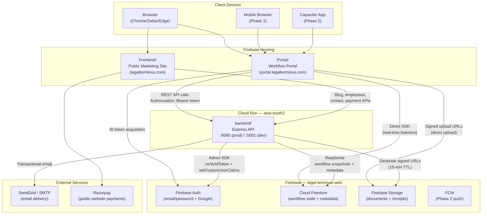

# Legal-Terminus Workflow Portal — Architecture Document

**Version**: 1.0  
**Date**: 2026-05-31  
**Author**: Winston (BMAD Architect Agent)  
**Status**: Draft — ready for developer review

---

## Table of Contents

1. [System Overview](#1-system-overview)
2. [Portal Frontend Architecture](#2-portal-frontend-architecture)
3. [Backend API Architecture](#3-backend-api-architecture)
4. [XState Workflow Engine — Detailed Design](#4-xstate-workflow-engine--detailed-design)
5. [Firestore Data Architecture](#5-firestore-data-architecture)
6. [Authentication & Authorisation](#6-authentication--authorisation)
7. [Document Storage](#7-document-storage)
8. [Notification Architecture](#8-notification-architecture)
9. [Deployment Architecture](#9-deployment-architecture)
10. [Development Environment](#10-development-environment)
11. [Open Technical Decisions](#11-open-technical-decisions)

---

## 1. System Overview

Legal-Terminus is a legal-services firm that replaces ad-hoc WhatsApp/email coordination with a structured, workflow-driven management portal. The system serves four roles — `admin`, `manager`, `team_member`, and `client` — coordinated through XState v5 state machines persisted in Firestore.

### 1.1 High-Level Component Diagram



### 1.2 How Portal and Frontend Coexist

| Concern | `Frontend/` | `Portal/` |
|---|---|---|
| Purpose | Public marketing website | Internal workflow portal |
| URL | `legalterminus.com` | `portal.legalterminus.com` |
| Firebase Hosting target | `public` site target | `portal` site target |
| Backend API | Uses existing routes (`/api/admin/blog`, `/api/employees`, etc.) | Adds new routes (`/api/tasks`, `/api/workflows`, etc.) |
| Auth | Not required (public) | Required (all routes protected) |
| Razorpay | Integrated for public service purchases | Not used in Phase 1 |

Both apps share the **same Cloud Run backend** and the same **Firebase project**. The backend distinguishes requests by path prefix. No route conflicts exist today, and new Portal routes use distinct prefixes.

---

## 1.3 ⚠️ IMPLEMENTATION UPDATE (2026-06-13) — Workflows are DATA-DRIVEN

> This supersedes the "hardcoded XState machine" framing in §2.5, §4, and §4.7 below.
> The XState **engine** is unchanged; what changed is that workflow **definitions are
> stored as data and compiled to machines at runtime**, so new flows (50+ planned) are
> documents — not code — and are editable without a deploy. Decided during an architecture
> review of the workflow Phase 1 (reusability/scalability for 50 flows). Multi-tenancy was
> explicitly **rejected** (system stays single-tenant).

**Shared module (`shared/workflows/`, plain ESM, imported by BOTH Portal and backend):**
- `definitionSchema.js` — the data shape of a workflow + `validateDefinition()`. A definition
  is `{ id, name, version, initialStep, steps[], phases?[] }`; each step has explicit `stepNumber`,
  `title`, `type` (`step|payment_gate|branch|final`), optional `assignedRole`, `effects[]`,
  `gate{requires,onPass,onWait}`, and `transitions[{event,to,branch?}]`. **Client-facing presentation
  (added 2026-06-13):** optional `phases[]` (`{id,name,order}`) group steps into journey milestones,
  with each step carrying an optional `phaseId` (plus optional `typicalDurationDays`, `clientActionLabel`,
  `ownerType`). `validateDefinition` rejects dangling `phaseId`s and malformed phases. These fields are
  **presentation-only** — the compiler ignores them, so workflow topology/behaviour is unaffected.
  Helper exports `deriveOwnerType` (explicit `ownerType` → a step assigned to the client via the
  `__CLIENT__` sentinel (`isClientAssignedStep`, #204) → payment_gate/`CLIENT_APPROVE`→client,
  `GOVT_APPROVE`→govt, else team),
  `stepPhaseMap`, and `phaseProgress(def, currentStep, stepStatuses?)` — phase done/now/upcoming computed
  from **real per-step statuses** so the final phase resolves to done on completion (cursor-only would
  not). Mirrored in `Portal/src/api/workflowDefinitions.ts` for the client.
  **Who may fire a step event (#204).** Ownership for *authorization* is the LIVE
  assignment, not the authored field: a step whose active instance lists `task.clientUid` among its
  assignees is the client's (unmaterialised → `deriveOwnerType`), except payment gates, client-hidden
  and admin-approval steps. On such a step the owning client may fire `COMPLETE_STEP` /
  `BRANCH_DECISION`; admin/manager doing so is an `onBehalfOfClient` override; a team member is
  refused — the same rule as `CLIENT_APPROVE`. `transitionTask` therefore loads the pinned definition
  before its authorization checks. The client's step rows carry a boolean `assignedToClient`
  (the uids themselves are stripped).
- `compileDefinition.js` — **compiles a definition → XState v5 machine** (gates → `always`
  guard + paired waiting state; branches → guarded `BRANCH_DECISION`; tracks `currentStepNumber`).
  Verified behaviourally **equivalent** to the legacy hand-written machine.
- `convertMachineToDefinition.js` — one-time converter (legacy machine → definition) used by the seed.
- `companyIncorporation.machine.js` — legacy machine, retained only as the seed source.

**Storage:** Firestore `workflowDefinitions/{id}` (e.g. `company-incorporation`, v1, 41 steps,
`serviceKeys:['incorporation']`). Seeded via `backend/src/scripts/seedWorkflowDefinitions.js`
(part of `npm run db:setup`). Editable from the UI in the upcoming Workflow Editor (BMAD E10-S01).

**Backend** (`backend/src/services/workflowDefinitions.service.js`): loads a definition by
`serviceKey` or `id`, compiles + caches by `id@version`. New endpoints:
`GET /api/workflow-definitions`, `GET /api/workflow-definitions/:id` (staff-only).

**Task model (created via `POST /api/tasks`, admin/manager):**
- Pins **`workflowDefinitionId` + `workflowVersion`** (immutable per task) — NOT the service key —
  so editing/versioning a flow never alters in-flight tasks. (`workflowType` kept as a back-compat
  mirror for reports.)
  > **Correction (#215, 2026-10-16): the version is RECORDED, not enforced.** Old
  > versions are not stored; `getCompiledById` returns the current definition, and
  > every transition, ETA and sweep runs on it. Step-level assignee/ETA settings are
  > copied into the step records at creation, which is why *those* edits reach only
  > new matters. The structure does not stay pinned: a step deleted from the service
  > is never reached by running matters. Its record — written at creation — is
  > therefore treated as gone when it was never started (`removedStepNumbers`):
  > hidden by `getTask`, deleted by `refreshCompletedStepCount(taskRef, serviceSteps)`
  > on the matter's next move. A record with history is kept. A transition that
  > returns to the same step is valid only when the step declares it
  > (`isDeclaredStay`, #214).
- Per-step **instance state** lives in a **subcollection** `tasks/{id}/steps/{stepNumber}`
  (status/assignee/title/assignedRole) — not an array on the task doc (avoids whole-array write
  races). A denormalized `totalSteps` is kept on the task for cheap list/report display.
- Payments (#148) live in a **subcollection** `tasks/{id}/payments/{paymentId}` — one doc per
  instalment received (amount / mode / paidAt / reference / notes / recordedBy). Same reasoning as
  `steps`: two people recording payments concurrently would clobber an array field. The task doc
  keeps **`amountPaid` / `amountDue` / `paymentStatus` as rollups** recomputed from the ledger on
  every add, edit and delete, so the summary card, matter list, reports and payment gate read
  unchanged fields. **The ledger is the only source of the paid figure (#202):**
  every money-moving write — record / correct / delete a payment, and `PATCH /payment` (which now
  accepts only `totalCost`, mode, description) — goes through ONE transaction, `commitLedgerChange`,
  which re-reads matter + ledger, applies the change, refuses overpayment (`PAYMENT_EXCEEDS_TOTAL`,
  also when the total is cut below what was paid) and writes rollups from the pure
  `paymentLedger.service.js` rules. `createTask` writes the creation payment as the first ledger
  row in its batch. A pre-ledger matter (`amountPaid > 0`, no rows) gets an explicit **opening
  balance** row on its first history read or ledger write — before, the first instalment
  recomputed from the empty ledger and silently wiped the figure. **Admin/manager only** —
  team members are refused all four endpoints and the Payments tab is removed from their UI;
  `firestore.rules` mirrors this (read admin/manager, writes denied).
- `ccEmails` (#149) on the task doc: additional recipients CC'd on every automated email for that
  matter. Stored on the MATTER, not the client profile, since one client can want different
  recipients per matter. The CC list is attached **only to the client's own copy** of an email —
  staff notifications are internal and are never broadcast to it.
- `GET /api/tasks` is paginated (`{ data, nextCursor }`) + role-scoped; composite indexes for
  role-scope × filter × `updatedAt` are in `firestore.indexes.json`.
- Zod validation on task endpoints (`backend/src/schemas/task.schema.js`).

**Assignment model (IMPORTANT — current state):**
- **`step.assignedRole`** (from the definition) = the *default responsible ROLE* (e.g. `team_member`).
- **`task.assignedTo` / `step.assignedTo`** = a specific USER (UID). `team_member` task-list
  scoping filters on `assignedTo == uid`.
- **`assignedTo` is `null` on creation.** Per-person assignment (2026-06-14) is built at two levels:
  - **Step:** `PATCH /api/tasks/:id/steps/:n { assignedTo }` sets/clears a step's assignee (admin/manager);
    "Step owner" picker in the step hero.
  - **Matter:** `PATCH /api/tasks/:id { assignedTo }` assigns the whole matter and **cascades onto the
    active step** (without clobbering a step delegated elsewhere); validates the assignee is staff;
    "Matter owner" control in the page header.
  - Assigning steps on creation, or not-yet-active steps in advance, remains future work.
- **My Tasks worklist:** `GET /api/tasks/my-steps` returns the **active step of every open matter** the
  caller is involved in — bucketed `assigned` / `unassigned` / `other`. Admin/manager see all open
  matters; **team members see matters task-assigned to them ∪ matters where a step is assigned to them**
  (the OR is resolved via a `collectionGroup('steps').where('assignedTo','==',uid)` query — needs the
  `steps.assignedTo` COLLECTION_GROUP field override, deployed 2026-06-14; degrades gracefully if absent).
- **Activity thread:** `GET /api/tasks/:id/events` returns the matter's audit events name-enriched; each
  entry references the actioned step (`fromStep`) resolved to *phase · Step N · title* via the definition.

**Visualizer:** the service detail page (`/services/:serviceKey`) fetches the definition from
`/api/workflow-definitions/:id` and compiles it client-side (read-only). Step identity (title/kind)
comes from the definition's explicit `meta`, not regex on state-key strings.

**Journey tracker (client progress view, BMAD E04-S08):** the Task detail Steps tab renders
`TaskJourneyTracker.tsx` above the step list — a phase "rail" (milestone stations), a next-stop hero
card, and a "steps remaining" ownership strip (client/team/registrar). It reads the definition's
`phases[]` + the task's per-step statuses (`GET /api/tasks/:id` already returns the `steps`
subcollection) and derives everything via the shared `phaseProgress` / `deriveOwnerType` helpers — no
new endpoints. Degrades to nothing when a workflow has no `phases`.

---

## 2. Portal Frontend Architecture

### 2.1 Directory Structure

```
Portal/
├── index.html
├── vite.config.ts
├── tsconfig.json
├── package.json
├── .env.local                    # Firebase config + API base URL
├── capacitor.config.ts           # Phase 2 — Capacitor native wrapper config
│
└── src/
    ├── main.tsx                  # App entry; Firebase init; StrictMode
    ├── App.tsx                   # Root router + auth provider
    │
    ├── routes/                   # React Router v7 route definitions
    │   ├── index.tsx             # createBrowserRouter — all routes
    │   ├── ProtectedRoute.tsx    # Auth + role guard wrapper
    │   └── RoleRedirect.tsx      # Redirects to role-specific home on login
    │
    ├── pages/                    # Organised by FEATURE, never by role (role-neutral)
    │   ├── auth/
    │   │   ├── LoginPage.tsx
    │   │   ├── SignupPage.tsx
    │   │   └── ForgotPasswordPage.tsx
    │   ├── dashboard/
    │   │   ├── DashboardPage.tsx          # ONE dashboard, all roles
    │   │   └── dashboardConfig.ts         # DASHBOARD_TILES (tiles filtered by role)
    │   ├── tasks/
    │   │   ├── TasksPage.tsx              # ONE tasks page, view adapts to role
    │   │   └── TaskDetailPage.tsx         # Steps | Documents | Payments tabs
    │   ├── workflow/
    │   │   └── WorkflowSettingsPage.tsx   # admin-only (via roles[], not folder)
    │   ├── users/
    │   │   ├── UsersPage.tsx              # all user roles, role filter tabs
    │   │   └── UserFormPage.tsx           # create/edit any user
    │   ├── reports/
    │   │   ├── ReportsPage.tsx            # report selector
    │   │   ├── AllTasksReport.tsx
    │   │   ├── CompletedTasksReport.tsx
    │   │   ├── PendingTasksReport.tsx
    │   │   ├── MasterSheetReport.tsx
    │   │   └── ContactLeadsReport.tsx
    │   ├── services/
    │   │   └── ServicesPage.tsx           # client service catalogue
    │   └── shared/
    │       ├── RootRedirect.tsx
    │       ├── UnauthorizedPage.tsx
    │       └── NotFoundPage.tsx
    │
    │   # ⚠️ NO role-named folders (no admin/, client/, manager/, team/).
    │   # Folders name the FEATURE; access is the route's roles[] in appRoutes.tsx.
    │
    ├── components/                # Reusable UI components (feature-named, not role-named)
    │   ├── layout/
    │   │   ├── AppLayout.tsx      # Shell: drawer sidebar + topbar + bottom nav
    │   │   ├── Sidebar.tsx        # Nav derived from APP_ROUTES (navConfig.ts)
    │   │   ├── BottomNav.tsx      # Mobile bottom nav
    │   │   ├── TopBar.tsx
    │   │   └── navConfig.ts       # Sidebar/bottom-nav derivation from APP_ROUTES
    │   ├── users/                 # ClientForm, TeamMemberForm (was components/admin/)
    │   ├── dashboard/             # DashboardTile, MyWorkWidget (urgent + approvals "waiting on you")
    │   ├── tasks/
    │   │   ├── StepCard.tsx
    │   │   ├── StepTimeline.tsx
    │   │   ├── PaymentBadge.tsx   # Blinking indicator
    │   │   ├── UrgentBadge.tsx    # (urgent now shown via Flame icon on detail; badge in lists)
    │   │   └── CreateMatterModal.tsx  # E11-S01 — create a matter (client + service picker)
    │   ├── documents/
    │   │   ├── DocumentUploader.tsx
    │   │   └── DocumentCard.tsx
    │   ├── payments/
    │   │   ├── RecordPaymentForm.tsx
    │   │   └── PaymentHistory.tsx
    │   └── common/                # shared primitives (NOTE: dir is common/, not shared/)
    │       ├── DataGrid.tsx       # E11-S06 — reusable sort/search/paginate grid + onRowClick
    │       ├── ConfirmDialog.tsx  # E11-S07 — ConfirmProvider (app-root); promise-based modal
    │       ├── confirmContext.ts  # E11-S07 — useConfirm() hook + context (split for fast-refresh)
    │       ├── PageShell.tsx
    │       ├── LoadingSpinner.tsx
    │       └── ErrorBoundary.tsx
    │
    ├── workflows/                 # XState workflow engine
    │   ├── configs/
    │   │   └── companyIncorporation.machine.ts   # Phase 1
    │   └── shared/
    │       ├── guards.ts          # paymentGateGuard, adminOverrideGuard, etc.
    │       ├── actors.ts          # documentReviewActor, emailTriggerActor
    │       ├── actions.ts         # sendEmailAction, writeAuditAction
    │       └── types.ts           # WorkflowContext, WorkflowEvent union
    │
    ├── hooks/                     # Custom React hooks
    │   ├── useAuth.ts             # Current user + role from Zustand store
    │   ├── useTask.ts             # TanStack Query wrapper for task data
    │   ├── useWorkflowMachine.ts  # XState useMachine wrapper
    │   ├── useNotifications.ts    # Firestore real-time listener
    │   └── useRequireRole.ts      # Redirect hook for unauthorized access
    │
    ├── api/                       # Backend API client (typed fetch wrappers)
    │   ├── client.ts              # Base fetch with Authorization header injection
    │   ├── tasks.api.ts
    │   ├── workflows.api.ts
    │   ├── users.api.ts
    │   ├── payments.api.ts
    │   ├── reports.api.ts
    │   └── notifications.api.ts
    │
    ├── store/                     # Zustand stores
    │   ├── authStore.ts           # Firebase user + decoded role claim
    │   └── uiStore.ts             # Sidebar open/close, global modals
    │
    ├── lib/                       # Firebase SDK init + helpers
    │   ├── firebase.ts            # initializeApp, getAuth, getFirestore, getStorage
    │   └── queryClient.ts         # TanStack Query client singleton
    │
    └── types/                     # Shared TypeScript types (Portal-side)
        ├── user.types.ts
        ├── task.types.ts
        ├── workflow.types.ts
        ├── payment.types.ts
        └── notification.types.ts
```

### 2.2 Role-Based Routing Strategy

**⚠️ ARCHITECTURE DECISION (2026-06-13, updated): Single declarative source of truth for routes + access + navigation, with ROLE-NEUTRAL URLs. Do NOT create per-role duplicate routes or role-prefixed paths.**

Two principles:

1. **Declarative access** — every authenticated route, the roles allowed to reach it, and its nav metadata live in **one table**: `Portal/src/routes/appRoutes.tsx` → `APP_ROUTES`. The router and navigation both derive from it.
2. **Role-neutral URLs** — paths name the **feature**, not the role. There are **no `/admin/*`, `/manager/*`, `/team/*`, `/client/*` prefixes**. A path is shared across roles; the page adapts its view to the current role internally, and the `roles` array controls access. This avoids leaking the role in the URL and eliminates per-role route duplication. One unified `/dashboard` and one `/tasks` serve all roles.

```tsx
// Portal/src/routes/appRoutes.tsx — the single source of truth
export interface AppRoute {
  path: string;
  element: ReactElement;
  roles: Role[];        // who can reach this page
  nav?: {               // omit for non-nav routes (edit forms, detail pages)
    label: string;
    mobileLabel?: string;
    icon: LucideIcon;
    mobile?: boolean;   // surface in mobile bottom nav
    order?: number;     // explicit nav ordering
  };
}

const ALL_ROLES: Role[] = ['admin', 'manager', 'team_member', 'client'];

export const APP_ROUTES: AppRoute[] = [
  // Shared across roles — one path, view adapts to role:
  { path: '/dashboard', element: <DashboardPage />, roles: ALL_ROLES,
    nav: { label: 'Dashboard', mobileLabel: 'Home', icon: LayoutDashboard, mobile: true, order: -2 } },
  { path: '/tasks', element: <TasksPage />, roles: ALL_ROLES,
    nav: { label: 'Tasks', icon: CheckSquare, mobile: true, order: -1 } },
  // Admin-only feature:
  { path: '/users', element: <AdminUsers />, roles: ['admin'],
    nav: { label: 'Users', icon: Users, mobile: true } },
  // Shared multi-role page — canonical path, listed ONCE:
  { path: '/reports/leads', element: <ContactLeadsReport />, roles: ['admin', 'team_member'] },
];
```

**Unified dashboard**: there is ONE `DashboardPage` (`Portal/src/pages/dashboard/`) for all roles. Its tiles come from a declarative `DASHBOARD_TILES` config (`dashboardConfig.ts`) filtered by role — same pattern as `APP_ROUTES`. No per-role dashboard components.

Three things derive from this one table — none requires touching the others:

1. **Router guards** (`Portal/src/routes/index.tsx`) — groups routes by identical role-set and wraps each group in a single `<ProtectedRoute allowedRoles={roles}>`. No manual route blocks.
2. **Sidebar + Bottom nav** (`Portal/src/components/layout/navConfig.ts`) — `navForRole(role)` / `mobileNavForRole(role)` filter `APP_ROUTES` by `roles` and `nav`.
3. **Access checks** — `ProtectedRoute` enforces `allowedRoles.includes(role)`; redirects to `/unauthorized` otherwise.

**Rules for adding/changing access:**
- To open a page to another role → add the role to that route's `roles` array. **One line.**
- **Use role-neutral paths.** Name the feature, not the role: `/tasks`, `/users`, `/reports/leads` — **never** `/admin/*`, `/team/*`, `/client/*`. The `roles` array is the access mechanism; the URL must not encode or leak the role.
- A page used by multiple roles → one canonical path, list every allowed role, and adapt the view inside the component by reading `role` from the auth store. **Never duplicate the route per role.**
- A reachable-but-not-linked page (edit form, detail view) → omit the `nav` block.

```tsx
// Portal/src/components/common/ProtectedRoute.tsx
export default function ProtectedRoute({ allowedRoles }: { allowedRoles: Role[] }) {
  const { user, role, isLoading } = useAuthStore();
  if (isLoading) return <LoadingSpinner />;
  if (!user) return <Navigate to="/login" replace />;
  if (!role || !allowedRoles.includes(role)) return <Navigate to="/unauthorized" replace />;
  return <Outlet />;
}
```

**Route tree summary** (abbreviated — full table is `APP_ROUTES` in `Portal/src/routes/appRoutes.tsx`). All paths role-neutral:

| Path | Allowed Roles | Component |
|---|---|---|
| `/login` | Public | `LoginPage` |
| `/dashboard` | all roles | `DashboardPage` (tiles filtered by role) |
| `/tasks` | all roles | `TasksPage` (view adapts to role) |
| `/tasks/:taskId` | all roles | `TaskDetailPage` |
| `/users`, `/users/new/:type`, `/users/edit/:type/:uid` | admin, manager | `UsersPage` / `UserFormPage` (manager cannot delete — E09-S01/S02) |
| `/reports`, `/reports/all-tasks`, `/reports/completed`, `/reports/pending`, `/reports/master-sheet` | admin, manager | Report pages |
| `/workflow-settings` | admin | `WorkflowSettingsPage` |
| `/services` | client | `ServicesPage` |
| `/reports/leads` | **admin, manager, team_member** | `ContactLeadsReport` (shared) |

`RootRedirect` sends `/` → `/dashboard` for any authenticated role (→ `/login` if not).

### 2.3 State Management Strategy

Three complementary layers — each with a distinct concern:

| Layer | Library | Concern |
|---|---|---|
| Workflow state | XState v5 (`useMachine`) | Step machine state, transitions, context |
| Server / async state | TanStack Query v5 | Task lists, user lists, reports — fetch + cache |
| Auth / session | Zustand | Firebase user object, decoded role, persistence |

**TanStack Query** handles all REST API reads and mutations. Cache keys are structured as `["tasks", taskId]`, `["tasks", "list", { clientUid }]`, etc. On a successful workflow transition mutation, the task query is invalidated to trigger a refetch.

**Zustand** (`Portal/src/store/authStore.ts`) holds the Firebase `User` object and the extracted `role` claim. It is hydrated once on app mount via `onAuthStateChanged` and kept in sync.

**XState** runs in-browser to drive the step timeline UI — it mirrors the backend machine state. The frontend receives the persisted `machineSnapshot` from the task document and rehydrates `createActor(machine, { snapshot })` to render current state reactively without additional API calls.

### 2.4 Auth Flow

```
1. User submits email/password (or Google) → Firebase Auth SDK (client-side)
2. Firebase returns ID token (JWT, short-lived ~1h)
3. Portal calls setPersistence(browserLocalPersistence) once on mount
4. Every API call: api/client.ts reads currentUser.getIdToken() → injects as
   Authorization: Bearer <token>
5. On token expiry, Firebase SDK auto-refreshes — getIdToken() always returns
   a valid token
6. Role is read from token.claims.role (populated by backend setCustomUserClaims)
7. On role change by admin, the next getIdToken(true) (force refresh) picks up
   the new claim
```

```ts
// Portal/src/api/client.ts
import { getAuth } from "firebase/auth";

const BASE_URL = import.meta.env.VITE_API_BASE_URL;

export async function apiFetch<T>(
  path: string,
  init: RequestInit = {}
): Promise<T> {
  const auth = getAuth();
  const token = await auth.currentUser?.getIdToken();
  const res = await fetch(`${BASE_URL}${path}`, {
    ...init,
    headers: {
      "Content-Type": "application/json",
      ...(token ? { Authorization: `Bearer ${token}` } : {}),
      ...init.headers,
    },
  });
  if (!res.ok) {
    const err = await res.json().catch(() => ({}));
    throw new ApiError(res.status, err.error ?? "Unknown error");
  }
  return res.json() as Promise<T>;
}
```

### 2.5 XState Config Sharing Strategy

> **Decision**: The XState machine config lives in **`Portal/src/workflows/`** (TypeScript source). The backend imports the compiled JS via a **local symlink or path alias** pointing to the same source tree — **not duplicated**, **not a separate npm package** in Phase 1.

Rationale: A separate npm package adds publish/version overhead that is unnecessary for a single-repo project in Phase 1. If the monorepo grows or backend is decoupled to a separate repo, the config can be extracted to a `packages/workflow-configs/` shared package at that point (flagged as TODO in §11).

Implementation:
- `backend/src/workflows/` → symlink to `Portal/src/workflows/` (or a `tsconfig.json` path alias if using `ts-node`/`tsx`)
- Backend uses `tsx` (or compiles with `tsc`) to consume TypeScript directly
- Alternative: `Portal/src/workflows/` is compiled to `Portal/dist/workflows/` and backend `package.json` references the compiled path

**Recommended approach for Phase 1**: Use `tsx` in the backend to run TypeScript directly, aliasing `#workflows` → `../Portal/src/workflows`. This avoids a build step on the backend during development.

---

## 3. Backend API Architecture

### 3.1 Middleware Stack

Every new Portal API route passes through the following middleware chain in order:

```
Request
  └─► cors()
  └─► express.json()
  └─► verifyToken          ← Firebase ID token → req.user = { uid, email, role }
  └─► requireRole(...)     ← Checks req.user.role against allowed roles
  └─► Route handler
  └─► Error handler        ← Catches thrown errors, returns standard JSON
```

`verifyToken` and `requireRole` already exist in `backend/src/middleware/auth.middleware.js` and are unchanged. New routes simply import them.

**Error response convention** (all API errors):
```json
{
  "success": false,
  "error": "Human-readable message",
  "code": "MACHINE_READABLE_CODE"    // optional, for UI switch statements
}
```

**Success response convention**:
```json
{
  "success": true,
  "data": { ... }          // or "items": [...] for lists
}
```

HTTP status codes: `200 OK`, `201 Created`, `400 Bad Request`, `401 Unauthorized`, `403 Forbidden`, `404 Not Found`, `409 Conflict`, `500 Internal Server Error`.

### 3.2 Route Structure

New Portal routes are registered in `backend/src/server.js` alongside the existing routes:

```js
// Additions to server.js — Portal routes
import taskRoutes       from "./routes/portal/tasks.routes.js";
import workflowRoutes   from "./routes/portal/workflows.routes.js";
import portalUserRoutes from "./routes/portal/users.routes.js";
import paymentRoutes2   from "./routes/portal/payments.routes.js";
import reportRoutes     from "./routes/portal/reports.routes.js";
import notifRoutes      from "./routes/portal/notifications.routes.js";

app.use("/api/tasks",         taskRoutes);
app.use("/api/workflows",     workflowRoutes);
app.use("/api/portal/users",  portalUserRoutes);   // /api/portal/users to avoid clash with existing /api/clients
app.use("/api/payments",      paymentRoutes2);
app.use("/api/reports",       reportRoutes);
app.use("/api/notifications", notifRoutes);
```

> **Note**: Existing `/api/clients` route serves the public website's contact form leads; new Portal client management is under `/api/portal/users` with role=client filter.

### 3.3 `/api/tasks` — Task Routes

| Method | Path | Roles | Description |
|---|---|---|---|
| `POST` | `/api/tasks` | admin, manager, team_member | Create new task (workflow instance) |
| `GET` | `/api/tasks` | admin, manager, team_member, client | List tasks (filtered by role/uid) |
| `GET` | `/api/tasks/my-steps` | admin, manager, team_member | Cross-matter step worklist ("My Tasks") — active step of each open matter, bucketed assigned/unassigned |
| `GET` | `/api/tasks/:taskId` | admin, manager, team_member, client | Get single task with steps |
| `GET` | `/api/tasks/:taskId/events` | admin, manager, team_member, client (own) | Activity thread — name-enriched audit events; entries reference the actioned step |
| `PATCH` | `/api/tasks/:taskId` | admin, manager | Update matter (isUrgent; **assignedTo** = matter owner, cascades to active step; **organisation** editable at any time incl. after completion (#153); **ccEmails** additional email recipients (#149)) |
| `DELETE` | `/api/tasks/:taskId` | admin | Hard-delete matter + cascade `steps`/`events`/`documents`/`payments` subcollections (explicit list — add new subcollections there) |
| `POST` | `/api/tasks/:taskId/transition` | admin, manager, team_member, client (own approval) | Fire workflow event (with optional `remark`), persist new state |
| `GET` | `/api/tasks/:taskId/steps` | admin, manager, team_member, client | List all steps for a task |
| `PATCH` | `/api/tasks/:taskId/steps/:stepId` | admin, manager | Update step (**assignedTo** = step owner, isUrgent) |
| `GET` | `/api/tasks/:taskId/payments` | admin, manager | Payment ledger (#148) — oldest first, each with the balance due after it. **Team and client refused (403)** |
| `POST` | `/api/tasks/:taskId/payments` | admin, manager | Record one payment received; rolls up amountPaid/amountDue/paymentStatus |
| `PATCH` | `/api/tasks/:taskId/payments/:paymentId` | admin, manager | Correct a recorded payment; re-rolls the totals |
| `DELETE` | `/api/tasks/:taskId/payments/:paymentId` | admin, manager | Remove a mistaken payment; re-rolls the totals |
| `POST` | `/api/tasks/:taskId/approve` | admin, manager | Approve pending task |
| `POST` | `/api/tasks/:taskId/reject` | admin, manager | Reject pending task with reason |

### 3.4 `/api/workflows` — Workflow Template Routes

| Method | Path | Roles | Description |
|---|---|---|---|
| `GET` | `/api/workflows` | admin, manager | List all workflow templates |
| `GET` | `/api/workflows/:workflowId` | admin | Get workflow template + all steps |
| `GET` | `/api/workflows/:workflowId/steps` | admin | List config-layer steps |
| `PATCH` | `/api/workflows/:workflowId/steps/:stepNumber` | admin | Update admin-editable step fields |
| `GET` | `/api/workflows/:workflowId/sync-check` | admin | Compare machine totalSteps vs config step count |

### 3.5 `/api/portal/users` — User Management Routes

**✅ IMPLEMENTED (2026-06-13) as the SINGLE user-management API.** The legacy split endpoints `/api/clients` and `/api/team-members` (and their controllers + the redundant `clients` collection) have been **removed**. All user types — admin, manager, team_member, client — live in the `users` collection; `role` is a field, not a separate endpoint. The portal `UsersPage` makes ONE call (`getUsers()`) instead of fetching+merging two lists. Backed by `backend/src/controllers/portalUsers.controller.js` + `routes/portalUsers.routes.js`; role validation/permissions come from `backend/src/config/roles.js` (the backend role service). Frontend helper: `Portal/src/api/users.ts`; frontend role service: `Portal/src/lib/roles.ts`.

| Method | Path | Roles | Description |
|---|---|---|---|
| `GET` | `/api/portal/users` | admin, manager | List all users (optional `?role=` filter) |
| `POST` | `/api/portal/users` | admin, manager | Create user (any role) + Firebase Auth account |
| `GET` | `/api/portal/users/:uid` | admin, manager | Get user profile |
| `PATCH` | `/api/portal/users/:uid` | admin, manager | Update profile fields (role change = admin only) |
| `DELETE` | `/api/portal/users/:uid` | admin | Delete user |
| `PATCH` | `/api/portal/users/:uid/role` | admin | Update role + setCustomUserClaims |
| `POST` | `/api/portal/users/:uid/bulk-reassign` | admin, manager | Reassign all open steps to another uid |

### 3.6 `/api/payments` — Payment Recording Routes

| Method | Path | Roles | Description |
|---|---|---|---|
| `POST` | `/api/payments` | admin, manager | Record a payment against a task |
| `GET` | `/api/payments?taskId=:taskId` | admin, manager, team_member, client | List payments for a task |
| `GET` | `/api/payments/:paymentId` | admin, manager | Get single payment record |

### 3.7 `/api/reports` — Reporting Routes

| Method | Path | Roles | Description |
|---|---|---|---|
| `GET` | `/api/reports/all-tasks` | admin, manager | All tasks with filters |
| `GET` | `/api/reports/completed` | admin, manager | Completed tasks |
| `GET` | `/api/reports/pending` | admin, manager | Pending tasks by reason |
| `GET` | `/api/reports/workload` | admin, manager | Per-team-member workload |
| `GET` | `/api/reports/delays` | admin, manager | Delays by cause + age bucket |
| `GET` | `/api/reports/payments` | admin, manager | Payment collection breakdown |
| `GET` | `/api/reports/services` | admin, manager | Tasks grouped by service type |
| `GET` | `/api/reports/clients` | admin, manager | Client list with activity |
| `GET` | `/api/reports/login-mapping` | admin | Email → client profile mapping + orphans |
| `GET` | `/api/reports/storage` | admin | Per-client storage usage + system total |
| `GET` | `/api/reports/master-sheet` | admin, manager | Full task table; accepts `?format=csv` |
| `GET` | `/api/reports/escalations` | admin, manager | Steps past deadline by team member |
| `GET` | `/api/reports/team-performance` | admin, manager | #216 Employee Performance: one person or the whole team over a period (see *Employee Performance report*) |
| `GET` | `/api/reports/team-performance/activity` | admin, manager | #216 activity feed, cursor-paginated |
| `GET` | `/api/reports/client-delays/:clientUid` | client | Client-facing delay summary (own tasks only) |

### 3.8 `/api/notifications` — Notification Routes

| Method | Path | Roles | Description |
|---|---|---|---|
| `GET` | `/api/notifications` | All authenticated | List own notifications (paginated) |
| `PATCH` | `/api/notifications/:notifId/read` | All authenticated | Mark notification as read |
| `POST` | `/api/notifications/broadcast` | admin | Push broadcast to client groups |
| `POST` | `/api/notifications/email-templates` | admin | Create/update email template |
| `GET` | `/api/notifications/email-templates` | admin | List all email templates |

### 3.9 XState Snapshot Hydration Flow (Backend)

The `POST /api/tasks/:taskId/transition` endpoint is the core workflow engine call:

```js
// backend/src/routes/portal/tasks.routes.js (transition handler, abbreviated)
import { createActor } from "xstate";
import { companyIncorporationMachine } from "#workflows/configs/companyIncorporation.machine.js";

router.post(
  "/:taskId/transition",
  verifyToken,
  requireRole("admin", "manager", "team_member"),
  async (req, res) => {
    const { taskId } = req.params;
    const { event } = req.body; // e.g. { type: "COMPLETE_STEP", stepId: "step_6" }

    // 1. Load persisted snapshot from Firestore
    const taskDoc = await getDoc("tasks", taskId);
    if (!taskDoc) return res.status(404).json({ success: false, error: "Task not found" });

    // 2. Authorisation: client can only send client-specific events
    enforceEventAuthorisation(req.user, event, taskDoc);

    // 3. Restore XState actor from persisted snapshot
    const machine = getMachineForWorkflow(taskDoc.workflowId); // returns correct machine
    const restoredSnapshot = taskDoc.machineSnapshot;
    const actor = createActor(machine, { snapshot: restoredSnapshot });
    actor.start();

    // 4. Send event
    actor.send(event);

    // 5. Extract new snapshot
    const newSnapshot = actor.getPersistedSnapshot();
    actor.stop();

    // 6. Persist new snapshot + derive step updates atomically (Firestore batch)
    const batch = db.batch();
    batch.update(taskRef, {
      machineSnapshot: newSnapshot,
      currentStepNumber: newSnapshot.context.currentStepNumber,
      updatedAt: new Date().toISOString(),
    });
    // Update affected step status in taskSteps/{taskId}/steps/{stepId}
    applySnapshotDiffToSteps(batch, taskId, restoredSnapshot, newSnapshot);
    await batch.commit();

    // 7. Trigger email/notification side-effects (fire-and-forget)
    triggerNotificationsForTransition(event, taskDoc, newSnapshot);

    res.json({ success: true, data: { snapshot: newSnapshot } });
  }
);
```

---

## 4. XState Workflow Engine — Detailed Design

### 4.1 Machine File

**File**: `Portal/src/workflows/configs/companyIncorporation.machine.ts`

```
Portal/src/workflows/
├── configs/
│   └── companyIncorporation.machine.ts   # Phase 1: 41 steps, all branches
├── shared/
│   ├── guards.ts     # paymentGateGuard, adminOverrideGuard, roleCheckGuard
│   ├── actors.ts     # documentReviewActor, emailTriggerActor
│   ├── actions.ts    # sendEmailAction, writeAuditAction, setCurrentStepAction
│   └── types.ts      # WorkflowContext, WorkflowEvent
```

### 4.2 `WorkflowContext` Interface

```ts
// Portal/src/workflows/shared/types.ts

export type PaymentStatus = "not_paid" | "part_paid" | "fully_paid";
export type TaskStatus =
  | "pending_manager_approval"
  | "pending_admin_approval"
  | "active"
  | "completed"
  | "rejected";

export interface WorkflowContext {
  taskId: string;
  clientUid: string;
  workflowId: string;

  // Payment tracking
  paymentStatus: PaymentStatus;
  amountTotal: number;
  amountPaid: number;

  // Current execution position
  currentStepNumber: number;
  activeStepIds: string[];       // multiple IDs when parallel group is active
  completedStepIds: string[];

  // Branch tracking
  resubmissionCount: number;     // increments each time a resubmission branch fires
  currentBranch?: "new_name" | "documentation" | "information" | "document_path";

  // Override tracking
  paymentOverrideBy?: string;    // uid of admin who overrode payment gate
  paymentOverrideReason?: string;
  paymentOverrideAt?: string;

  // Delay tracking
  delayDueTo?: "lt" | "client" | "government";

  // Admin metadata (populated at task creation from config layer)
  stepMetadata: Record<string, StepMetadata>;  // stepNumber → config-layer data
}

export interface StepMetadata {
  label: string;
  description: string;
  deadlineDays: number;
  defaultAssigneeRole: "team_member" | "manager" | "client";
  documentRequirementText?: string;
  emailTemplateRef?: string;
  sendReminderAfterDays?: number;
}
```

### 4.3 Event Catalogue

All events the machine accepts:

| Event Type | Payload | Who Sends | Description |
|---|---|---|---|
| `COMPLETE_STEP` | `{ stepId, completedBy }` | team_member, manager, admin | Mark current step as complete; advance machine |
| `REJECT_DOCUMENT` | `{ stepId, docId, remark }` | team_member, manager | Reject uploaded document; client notified |
| `APPROVE_DOCUMENT` | `{ stepId, docId }` | team_member, manager | Approve document; step can advance |
| `RECORD_PAYMENT` | `{ amount, mode, date, referenceNumber? }` | admin, manager | Record payment; recalculate paymentStatus |
| `PAYMENT_CONFIRMED` | `{ paymentStatus }` | system (via backend after payment) | Fired automatically when payment gate is satisfied |
| `ADMIN_OVERRIDE_PAYMENT` | `{ reason, adminUid }` | admin only | Bypass payment guard; write to audit |
| `BRANCH_DECISION` | `{ branch: "new_name" \| "documentation" }` | team_member, manager | Taken at resubmission decision point |
| `RESUBMIT` | `{ targetStepNumber }` | team_member | Loop back to earlier step (resubmission path) |
| `CLIENT_APPROVE` | `{ stepId }` | client | Client approves a draft or document |
| `CLIENT_REJECT` | `{ stepId, reason }` | client | Client rejects; triggers loop-back |
| `REQUEST_CORRECTION` | `{ stepId, reason }` | client | Grace-period reversal request |
| `APPROVE_CORRECTION` | `{ stepId }` | team_member, admin | Reverse a client approval/rejection |
| `TASK_APPROVED` | `{ approvedBy }` | admin, manager | Task moves from pending_approval → active |
| `TASK_REJECTED` | `{ rejectedBy, reason }` | admin, manager | Task rejected with reason |
| `REASSIGN_STEP` | `{ stepId, toUid }` | admin, manager, team_member | Reassign step to different team member |
| `MARK_URGENT` | `{ stepId }` | admin, manager | Set isUrgent flag |
| `CLEAR_URGENT` | `{ stepId }` | admin, manager | Clear isUrgent flag (auto on completion) |

### 4.4 Shared Actors and Guards

```ts
// Portal/src/workflows/shared/guards.ts

export const paymentGateGuard = ({ context }: { context: WorkflowContext }) =>
  context.paymentStatus === "fully_paid";

export const partPaymentAllowedGuard = ({ context }: { context: WorkflowContext }) =>
  context.paymentStatus !== "not_paid"; // part_paid or fully_paid

export const adminOverrideGuard = (
  { context }: { context: WorkflowContext },
  event: { type: "ADMIN_OVERRIDE_PAYMENT"; adminUid: string }
) => !!event.adminUid; // actual role check happens in backend before event is accepted

export const clientApprovalPendingGuard = ({ context }: { context: WorkflowContext }) =>
  context.activeStepIds.some((id) => context.stepMetadata[id]?.defaultAssigneeRole === "client");

export const allParallelCompleteGuard = ({ context }: { context: WorkflowContext }) =>
  context.activeStepIds.every((id) => context.completedStepIds.includes(id));
```

```ts
// Portal/src/workflows/shared/actors.ts

// documentReviewActor: invoked actor that waits for APPROVE_DOCUMENT or REJECT_DOCUMENT
export const documentReviewActor = fromCallback(({ sendBack, receive }) => {
  receive((event) => {
    if (event.type === "APPROVE_DOCUMENT") sendBack({ type: "DOCUMENT_APPROVED" });
    if (event.type === "REJECT_DOCUMENT")  sendBack({ type: "DOCUMENT_REJECTED", remark: event.remark });
  });
});

// emailTriggerActor: fire-and-forget actor that calls the email API
export const emailTriggerActor = fromPromise(async ({ input }: { input: EmailTriggerInput }) => {
  await apiFetch("/api/notifications/send-email", {
    method: "POST",
    body: JSON.stringify(input),
  });
});
```

### 4.5 Machine Topology (Company Incorporation — abbreviated)

```ts
// Portal/src/workflows/configs/companyIncorporation.machine.ts (structural outline)

export const companyIncorporationMachine = createMachine({
  id: "companyIncorporation",
  initial: "payment_gate",
  context: ({ input }: { input: Partial<WorkflowContext> }) => ({
    ...defaultContext,
    ...input,
  }),

  states: {
    payment_gate: {
      // Steps 1–2: three-way branch on payment
      on: {
        RECORD_PAYMENT: [
          { guard: "paymentGateGuard",    target: "work_assignment" },
          { guard: "partPaymentAllowed",  target: "work_assignment" },
          { target: "awaiting_payment" },
        ],
        TASK_APPROVED: { target: "work_assignment" }, // admin override on no-payment
      },
    },

    awaiting_payment: {
      // Task created with not_paid — sits here until RECORD_PAYMENT or TASK_APPROVED
      entry: "setPaymentBlinkingIndicator",
      on: {
        RECORD_PAYMENT: { target: "work_assignment" },
        ADMIN_OVERRIDE_PAYMENT: { guard: "adminOverrideGuard", target: "work_assignment" },
      },
    },

    work_assignment: { /* Step 3 */ },

    name_collection: {
      // Steps 4–10: collect name, client approval, loop on rejection
      type: "compound",
      initial: "collect_name",
      states: {
        collect_name: { on: { COMPLETE_STEP: "name_search" } },
        name_search: { on: { COMPLETE_STEP: "send_draft_to_client" } },
        send_draft_to_client: { entry: "sendEmailAction", on: { COMPLETE_STEP: "awaiting_client_approval" } },
        awaiting_client_approval: {
          on: {
            CLIENT_APPROVE: "#companyIncorporation.name_filing",
            CLIENT_REJECT: "collect_name", // loop back to step 6
          },
        },
      },
    },

    name_filing: {
      // Steps 11–13: file, await govt, receive result
      /* ... */
      on: {
        COMPLETE_STEP: [
          { target: "name_approved" },
          { target: "resubmission_branch" }, // if resubmission received
        ],
      },
    },

    resubmission_branch: {
      // Steps 14–19: branch decision
      on: {
        BRANCH_DECISION: [
          { guard: ({ event }) => event.branch === "new_name",      target: "name_collection" },
          { guard: ({ event }) => event.branch === "documentation", target: "resubmission_docs" },
        ],
      },
    },

    resubmission_docs: { /* Steps 16b–19: prepare, approve, resubmit */ },

    name_approved: {
      // Step 20: receive approval letter
      entry: "sendEmailAction",
      on: { COMPLETE_STEP: "part_payment_gate" },
    },

    part_payment_gate: {
      // Step 21: blinking indicator
      entry: "setPaymentBlinkingIndicator",
      on: {
        PAYMENT_CONFIRMED: { target: "incorporation_docs" },
        ADMIN_OVERRIDE_PAYMENT: { guard: "adminOverrideGuard", target: "incorporation_docs" },
      },
    },

    incorporation_docs: {
      // Steps 22–26: allowedWithoutPayment = true for these steps
      /* parallel sub-states for DSC group */
      type: "parallel",
      states: {
        doc_preparation: { /* Steps 22–24 */ },
        form_fill: { /* Steps 25–26 */ },
      },
      onDone: { target: "full_payment_gate" },
    },

    full_payment_gate: {
      // Step 27: full payment confirmed
      on: {
        PAYMENT_CONFIRMED: { guard: "paymentGateGuard", target: "upload_forms" },
      },
    },

    upload_forms: {
      // Step 28: paymentGated = true; admin override only
      entry: "validateFullPayment",
      on: {
        COMPLETE_STEP: { guard: "paymentGateGuard", target: "challan_payment" },
        ADMIN_OVERRIDE_PAYMENT: { guard: "adminOverrideGuard", target: "challan_payment" },
      },
    },

    // Steps 29–41: challan, govt approval, second resubmission branch, COI, final
    challan_payment: { /* Step 29 */ },
    govt_approval: { /* Steps 30–37 */ },
    certificate_received: { /* Steps 38–40: entry triggers email to client */ },
    master_sheet_update: {
      // Step 41: terminal state
      type: "final",
      entry: "markTaskCompleted",
    },
  },
}, {
  guards: { paymentGateGuard, partPaymentAllowed: partPaymentAllowedGuard, adminOverrideGuard, allParallelComplete: allParallelCompleteGuard },
  actors: { documentReviewActor, emailTriggerActor },
  actions: { sendEmailAction, writeAuditAction, setCurrentStepAction, markTaskCompleted, setPaymentBlinkingIndicator },
});
```

### 4.6 Firestore Snapshot Storage

The machine snapshot is stored in-line in `tasks/{taskId}`:

```
tasks/{taskId} {
  ...taskFields,
  machineSnapshot: {
    value: "name_collection.awaiting_client_approval",   // XState state value
    context: { ...WorkflowContext },                      // full context object
    status: "active"                                      // "active" | "done" | "error"
  }
}
```

- Stored as a plain Firestore map field — no sub-collection overhead
- Written atomically in a Firestore batch with step status updates
- The backend reads `taskDoc.machineSnapshot` and passes it directly to `createActor(machine, { snapshot })`
- `getPersistedSnapshot()` returns a JSON-serialisable object — no custom serialisers needed

### 4.7 Config Layer Merge at Task Creation

```
POST /api/tasks
  │
  ├─ 1. Read workflowTemplates/{workflowType}/steps (config layer — all steps)
  │
  ├─ 2. createActor(machine, { input: { taskId, clientUid, paymentStatus, stepMetadata } })
  │       └─ stepMetadata built from config layer: { [stepNumber]: StepMetadata }
  │
  ├─ 3. actor.start() → initial snapshot
  │
  ├─ 4. Firestore batch:
  │       ├─ tasks/{taskId} ← task doc + machineSnapshot
  │       └─ taskSteps/{taskId}/steps/{stepId} ← one doc per step (populated from
  │              config layer: label, deadline, assignedTo, status = pending/active)
  │
  └─ 5. Notify client + assigned team member
```

---

## 5. Firestore Data Architecture

### 5.1 Collections and Security Rules Strategy

**⚠️ `users/{uid}` canonical fields (2026-06-13):** `name` and `phone` are the **canonical** fields. `fullName` and `mobile` are legacy aliases kept mirrored for backward compatibility. All writes flow through `normalizeUserProfile()` in `backend/src/services/userService.js` (applied in `upsertUser` and `portalUsers.updateUser`), which accepts either alias and always persists the canonical field + mirror. Existing docs were normalized via `backend/scripts/backfill-user-names.js` (idempotent; `npm run backfill:user-names`). New code should read `name`/`phone`; the frontend `displayName()` helper (`Portal/src/api/users.ts`) provides a `name → fullName → email` fallback for safety.

| Collection | Who Reads | Who Writes | Security Strategy |
|---|---|---|---|
| `users/{uid}` | Owner (own doc), admin, manager | Owner (own limited fields), admin, manager | User reads own; admin/manager read all; only admin can write `role`. Canonical name/phone fields (see note above). |
| `workflowTemplates/{wfId}` | admin, manager (top-level), backend | admin only (steps sub-collection) | Public read locked down; write = admin-only custom claim check |
| `workflowTemplates/{wfId}/steps/{stepNo}` | admin (via portal) | admin only | Sub-collection inherits parent; UI calls backend PATCH not direct Firestore write |
| `tasks/{taskId}` | Owner client (own), assigned team member, admin, manager | Backend only (not direct client write) | Client reads tasks where `clientUid == uid`; team member reads tasks where any step `assignedTo == uid`; writes always go through backend |
| `taskSteps/{taskId}/steps/{stepId}` | Same as parent task | Backend only | Mirrors parent task access |
| `documents/{taskId}/files/{docId}` | Task participants | Client (upload), backend (review status) | Client writes own uploads; review status written by backend only |
| `notifications/{uid}/items/{notifId}` | Owner uid only | Backend (write), owner (mark read) | `request.auth.uid == uid` for both read and write; clients cannot write to other UIDs |
| `payments/{paymentId}` | admin, manager, task client | admin, manager (via backend only) | No direct client write; client reads own task payments |
| `auditLog/{entryId}` | admin, manager | Backend only | Write: backend service account; read: admin/manager |

**Security rule philosophy**: Never allow direct client-side writes to `tasks`, `taskSteps`, `payments`, or `auditLog`. All writes go through the backend, which enforces business logic + auth. Direct Firestore writes from the client are limited to:
- `notifications/{uid}/items/{notifId}` — mark as read (own only)
- `documents/{taskId}/files/{docId}` — client uploads (size + type validated by Storage Rules)

### 5.2 Indexing Strategy

Composite indexes needed for common queries (define in `firestore.indexes.json`):

| Collection | Index Fields | Query Pattern |
|---|---|---|
| `tasks` | `clientUid ASC, createdAt DESC` | Client views own tasks sorted by date |
| `tasks` | `status ASC, createdAt DESC` | Admin pending task list |
| `tasks` | `workflowId ASC, status ASC` | Service category report |
| `taskSteps/{taskId}/steps` | `assignedTo ASC, status ASC` | Team member step queue |
| `taskSteps/{taskId}/steps` | `status ASC, deadline ASC` | Escalation report (overdue steps) |
| `taskSteps/{taskId}/steps` | `parallelGroup ASC, status ASC` | Parallel group completion check |
| `payments` | `taskId ASC, date DESC` | Payment history for a task |
| `payments` | `mode ASC, date DESC` | Payment report by mode |
| `notifications/{uid}/items` | `read ASC, createdAt DESC` | Unread notifications first |
| `auditLog` | `entityType ASC, entityId ASC, performedAt DESC` | Audit trail for an entity |

### 5.3 Real-Time Subscriptions vs. On-Demand Fetches

| Data | Strategy | Rationale |
|---|---|---|
| `notifications/{uid}/items` | **Real-time** `onSnapshot` | Immediate delivery of in-app alerts |
| `tasks/{taskId}` (open task detail page) | **Real-time** `onSnapshot` | Team member and client see step status change live |
| `taskSteps/{taskId}/steps` (task detail) | **Real-time** `onSnapshot` | Step progression visible without manual refresh |
| Task list (dashboard) | **On-demand** (TanStack Query, refetch on focus) | List is large; real-time on all tasks is expensive |
| Reports | **On-demand** with manual refresh | Aggregated data; stale-by-seconds is acceptable |
| User/client profiles | **On-demand** | Low change frequency |
| Workflow templates | **On-demand** + cache (long TTL) | Changes are infrequent (admin edit only) |
| Payments for a task | **On-demand** | Loaded when user opens Payments tab |

---

## 6. Authentication & Authorisation

### 6.1 Firebase Auth Custom Claims Flow

```
Admin calls PATCH /api/portal/users/:uid/role { role: "manager" }
  │
  ├─ Backend: verifyToken (caller must be admin)
  ├─ Backend: admin.auth().setCustomUserClaims(uid, { role: "manager" })
  ├─ Backend: db.collection("users").doc(uid).update({ role: "manager" })
  └─ Response: { success: true }

Client side — forcing token refresh to pick up new claim:
  await getAuth().currentUser.getIdToken(true)   // forceRefresh = true
  // Zustand authStore updates role from new token claims
```

The `role` claim is set at two points:
1. **Registration** (`POST /api/auth/register`): always sets `role: "client"` (existing code)
2. **Role update** (`PATCH /api/portal/users/:uid/role`): sets any valid role (admin only)

Custom claims are verified on every protected request in `verifyToken` middleware (existing `backend/src/middleware/auth.middleware.js`) — no Firestore read needed per request.

### 6.2 Backend Token Verification

The existing `verifyToken` middleware in `backend/src/middleware/auth.middleware.js` is unchanged:

```js
// Decodes: { uid, email, role, iat, exp, ... }
const decoded = await admin.auth().verifyIdToken(token);
req.user = decoded;
```

`requireRole()` then checks `req.user.role` against the allowed roles array. This is already implemented and is applied to all new Portal routes.

### 6.3 Frontend Route Guards

```tsx
// Portal/src/hooks/useAuth.ts
import { useAuthStore } from "../store/authStore";

export function useAuth() {
  const { user, role, loading } = useAuthStore();
  return { user, role, loading, isAuthenticated: !!user };
}

// authStore.ts initialises on mount:
onAuthStateChanged(auth, async (user) => {
  if (user) {
    const token = await user.getIdToken();
    const decoded = jwtDecode(token);       // client-side decode (no verification needed here)
    set({ user, role: decoded.role as Role, loading: false });
  } else {
    set({ user: null, role: null, loading: false });
  }
});
```

`ProtectedRoute` in `Portal/src/routes/ProtectedRoute.tsx` wraps all authenticated routes and redirects to `/login` if unauthenticated or `/unauthorized` if insufficient role.

### 6.4 Session Persistence

```ts
// Portal/src/lib/firebase.ts
import { getAuth, setPersistence, browserLocalPersistence } from "firebase/auth";

const auth = getAuth(app);
setPersistence(auth, browserLocalPersistence); // persists across browser sessions
```

For Phase 2 (Capacitor), switch to `indexedDBLocalPersistence` which works in both web and native Capacitor environments.

---

## 7. Document Storage

### 7.1 Storage Path Convention

```
Firebase Storage bucket: legal-terminus-web.appspot.com

documents/{taskId}/{stepId}/{fileName}
  └─ e.g. documents/task_abc123/step_24/aadhaar_scan.pdf

payments/{taskId}/{paymentId}/{proofFileName}
  └─ e.g. payments/task_abc123/pay_001/bank_receipt.jpg
```

All paths include `taskId` as the second segment, making it possible to set Storage Security Rules by path prefix matching the task ownership.

### 7.2 Upload Flow (Client → Storage Direct, Bypassing Backend Bandwidth)

```
Client browser                Backend                  Firebase Storage
     │                           │                           │
     │── POST /api/tasks/:id/documents/signed-upload-url ──►│
     │     { stepId, fileName, contentType }                 │
     │                           │── generateSignedUrl(...)─►│
     │                           │◄── signedUrl (PUT, 15min)─│
     │◄── { signedUrl, docId } ──│                           │
     │                           │                           │
     │────── PUT signedUrl ────────────────────────────────►│
     │         (direct browser → Storage; no backend)        │
     │◄────── 200 OK ─────────────────────────────────────── │
     │                           │                           │
     │── POST /api/tasks/:id/documents/:docId/confirm ──────►│
     │     { uploaded: true }    │                           │
     │                           │── Write documents/{taskId}/files/{docId} ──►Firestore
     │                           │── Notify team member ────►notifications
     │◄── { success: true } ─────│
```

**Backend signed upload URL generation**:
```js
const [signedUrl] = await storage
  .bucket()
  .file(`documents/${taskId}/${stepId}/${sanitizedFileName}`)
  .getSignedUrl({
    version: "v4",
    action: "write",
    expires: Date.now() + 15 * 60 * 1000,  // 15 minutes
    contentType: allowedMimeType,
  });
```

**Allowed MIME types**: `application/pdf`, `image/jpeg`, `image/png`, `image/webp` — enforced both in the signed URL `contentType` parameter and Firebase Storage Security Rules.

### 7.3 Download (Signed Read URL)

```
GET /api/tasks/:taskId/documents/:docId/signed-download-url
  → Backend validates caller has access to this task
  → generates 15-min signed GET URL
  → returns { signedUrl }
```

Documents are **never** served via public URLs. All access is through backend-generated time-limited signed URLs.

### 7.4 Auto-Deletion Policy

**Strategy**: Firestore TTL (native, zero-cost) + Cloud Function fallback.

- `documents/{taskId}/files/{docId}` has field `expiresAt = uploadedAt + 365 days`
- Firestore TTL is **not** enabled on document metadata (metadata must be preserved for audit)
- Instead: a **Cloud Function** (`onSchedule`, daily trigger) queries `documents` where `expiresAt < now() - 30 days` (30-day advance warning window)
  - At `expiresAt - 30 days`: sends email + in-app notification to client ("download your documents")
  - At `expiresAt`: deletes the Storage file, marks `documents/{docId}.status = "deleted"`, records in auditLog
- **Paid storage extension**: admin can set `expiresAt` forward by 1 year; records a `storage_extension` payment event

> **TODO §11.2**: Cloud Functions vs. Cloud Run for document auto-deletion — see Open Technical Decisions.

---

## 8. Notification Architecture

### 8.1 In-App Notifications (Real-Time)

```
Firestore: notifications/{uid}/items/{notifId}
  {
    uid, type, title, body, deepLink,
    read: false,
    createdAt,
    taskId?, stepId?
  }
```

Backend writes a notification document after every meaningful event (step completion, document rejection, payment confirmation, etc.). The frontend subscribes with `onSnapshot`:

```ts
// Portal/src/hooks/useNotifications.ts
import { collection, query, orderBy, limit, onSnapshot, where } from "firebase/firestore";

export function useNotifications(uid: string) {
  const [notifications, setNotifications] = useState<Notification[]>([]);

  useEffect(() => {
    const q = query(
      collection(db, `notifications/${uid}/items`),
      where("read", "==", false),
      orderBy("createdAt", "desc"),
      limit(50)
    );
    return onSnapshot(q, (snap) => {
      setNotifications(snap.docs.map((d) => d.data() as Notification));
    });
  }, [uid]);

  return notifications;
}
```

The `NotificationBell` component in the app shell displays the unread count from this hook reactively.

**Deep links** in notification `deepLink` field:
- Step completion → `/tasks/{taskId}?tab=steps`
- Document rejection → `/tasks/{taskId}?tab=documents&stepId={stepId}`
- Payment due → `/tasks/{taskId}?tab=payments`
- Broadcast → `/notifications`

### 8.2 Email Notifications

Email is sent from the backend after every workflow transition using **Nodemailer** with SMTP (configurable via env vars to use SendGrid SMTP relay).

```js
// backend/src/utils/email.service.js
import nodemailer from "nodemailer";

const transporter = nodemailer.createTransport({
  host: process.env.SMTP_HOST,
  port: Number(process.env.SMTP_PORT) || 587,
  secure: false,
  auth: { user: process.env.SMTP_USER, pass: process.env.SMTP_PASS },
});

export async function sendWorkflowEmail({ to, templateRef, variables }) {
  const template = await getEmailTemplate(templateRef);  // from Firestore emailTemplates/
  const html = renderTemplate(template.html, variables);
  try {
    await transporter.sendMail({ from: process.env.SMTP_FROM, to, subject: template.subject, html });
  } catch (err) {
    // Write failure to Firestore notifications for admin
    await writeDeliveryFailureAlert(to, err.message);
  }
}
```

Email templates are stored in Firestore `emailTemplates/{templateId}` and edited by admin via the portal. Variables like `{{clientName}}`, `{{stepLabel}}`, `{{deepLink}}` are interpolated at send time.

**Multi-email clients**: `sendWorkflowEmail` accepts an array for `to` — all addresses in `user.emailIds[]` receive copies.

**Delivery failure alerting**: on `sendMail` error, the backend writes to `notifications/{adminUid}/items` and `notifications/{managerUid}/items` with type `EMAIL_DELIVERY_FAILURE`.

### 8.3 Push Notifications (Phase 2)

FCM token stored in `users/{uid}.fcmToken` (updated by the Capacitor app on launch). Backend sends via Firebase Admin SDK:

```js
// Phase 2
await admin.messaging().send({
  token: userDoc.fcmToken,
  notification: { title, body },
  data: { deepLink },
});
```

---

## 9. Deployment Architecture

### 9.1 Firebase Hosting — Portal and Frontend Coexistence

Both apps are deployed to the **same Firebase project** (`legal-terminus-web`) but as **separate hosting sites** using Firebase multi-site hosting:

```json
// firebase.json (additions for Portal)
{
  "hosting": [
    {
      "target": "public-site",
      "public": "Frontend/dist",
      "rewrites": [{ "source": "**", "destination": "/index.html" }]
    },
    {
      "target": "portal",
      "public": "Portal/dist",
      "rewrites": [
        { "source": "/api/**", "run": { "serviceId": "legal-terminus-qa", "region": "asia-south2" } },
        { "source": "**", "destination": "/index.html" }
      ]
    }
  ]
}
```

Firebase hosting targets are configured in `.firebaserc`:

```json
{
  "projects": { "default": "legal-terminus-web" },
  "targets": {
    "legal-terminus-web": {
      "hosting": {
        "public-site": ["legal-terminus-web"],
        "portal": ["legal-terminus-portal"]
      }
    }
  }
}
```

**URL strategy**:
- `legalterminus.com` → `public-site` target (`Frontend/dist`)
- `portal.legalterminus.com` → `portal` target (`Portal/dist`) — CNAME to Firebase Hosting

### 9.2 Backend — Cloud Run

```
Service:    legal-terminus-qa
Region:     asia-south2
Image:      gcr.io/legal-terminus-web/backend:$TAG
Port:       8080 (process.env.PORT)
Instances:  0 min, 5 max (scale-to-zero)
Memory:     512Mi
CPU:        1
```

**Dockerfile** (existing at repo root — assumed to be for backend):

```dockerfile
FROM node:20-alpine
WORKDIR /app
COPY backend/package*.json ./
RUN npm ci --omit=dev
COPY backend/ .
ENV PORT=8080
CMD ["node", "src/server.js"]
```

> **Note**: If the backend is to consume TypeScript workflow configs directly (via `tsx`), add `tsx` to production dependencies and update the CMD: `CMD ["npx", "tsx", "src/server.js"]`. Alternatively, add a `tsc` build step in the Dockerfile.

### 9.3 Environment Variables and Secrets

**Never commit secrets to the repository.** All secrets are injected at runtime.

**`Portal/.env.local`** (git-ignored, client-side, all `VITE_` prefixed):
```
VITE_API_BASE_URL=http://localhost:5001
VITE_FIREBASE_API_KEY=
VITE_FIREBASE_AUTH_DOMAIN=legal-terminus-web.firebaseapp.com
VITE_FIREBASE_PROJECT_ID=legal-terminus-web
VITE_FIREBASE_STORAGE_BUCKET=legal-terminus-web.appspot.com
VITE_FIREBASE_MESSAGING_SENDER_ID=
VITE_FIREBASE_APP_ID=
VITE_FIREBASE_MEASUREMENT_ID=
```

**`backend/.env`** (git-ignored, server-side):
```
PORT=5001
FIREBASE_PROJECT_ID=legal-terminus-web
FIREBASE_CLIENT_EMAIL=
FIREBASE_PRIVATE_KEY=
VITE_FIREBASE_API_KEY=         # served via /api/auth/firebase-config endpoint
VITE_FIREBASE_AUTH_DOMAIN=
VITE_FIREBASE_PROJECT_ID=legal-terminus-web
VITE_FIREBASE_STORAGE_BUCKET=
VITE_FIREBASE_MESSAGING_SENDER_ID=
VITE_FIREBASE_APP_ID=
VITE_FIREBASE_MEASUREMENT_ID=
SMTP_HOST=
SMTP_PORT=587
SMTP_USER=
SMTP_PASS=
SMTP_FROM=noreply@legalterminus.com
```

**Cloud Run** — secrets set via `gcloud run services update` or the Cloud Console:
```
FIREBASE_PROJECT_ID, FIREBASE_CLIENT_EMAIL, FIREBASE_PRIVATE_KEY,
SMTP_HOST, SMTP_PORT, SMTP_USER, SMTP_PASS, SMTP_FROM
```

Firebase credentials (`FIREBASE_CLIENT_EMAIL`, `FIREBASE_PRIVATE_KEY`) are sourced from a **Service Account key** — or better, use **Workload Identity Federation** on Cloud Run to avoid key management entirely.

### 9.4 CI/CD

Existing: `.github/workflows/firebase-preview-qa.yml` (deploys to QA on PR). Extensions needed:

- Add a job to build `Portal/` (`npm run build`) and deploy to the `portal` Firebase Hosting target
- Add a job to build the backend Docker image and deploy to Cloud Run on merge to `main`

---

## 10. Development Environment

### 10.1 Monorepo Structure

```
/Legal-Terminus/              ← Git root
├── _bmad/                    ← BMAD framework (agents, skills, config)
├── _bmad-output/
│   ├── planning-artifacts/   ← PRD, architecture, stories (output here)
│   └── implementation-artifacts/
├── .agents/                  ← GitHub Copilot agent skill files
├── .github/                  ← CI/CD workflows + Copilot agent commands
├── backend/                  ← Node.js/Express API (ES Modules)
│   ├── src/
│   │   ├── server.js
│   │   ├── config/           ← firebase.js, firestore.js
│   │   ├── controllers/
│   │   ├── middleware/       ← auth.middleware.js (verifyToken, requireRole)
│   │   ├── models/
│   │   ├── routes/           ← existing public routes
│   │   │   └── portal/       ← NEW: Portal-specific routes
│   │   └── utils/
│   ├── package.json
│   └── .env                  ← git-ignored
├── docs/                     ← Project knowledge (requirements, workflow steps)
├── Frontend/                 ← Public marketing website (Vite + React, UNCHANGED)
│   └── src/
├── Portal/                   ← NEW: Workflow portal (Vite + React 19 + TypeScript)
│   └── src/
├── spec.md                   ← Feature specification (source of truth for stories)
├── firebase.json             ← Firebase multi-site hosting config
├── .firebaserc
└── Dockerfile                ← Backend container image
```

### 10.2 Local Development

**Prerequisites**: Node 26 (`.nvmrc`; run `nvm use`), Firebase CLI, optionally Firebase Emulators.

**Start backend** (port 5001):
```sh
cd backend
npm install
node src/server.js          # or: npx tsx src/server.js (if using TypeScript imports)
```

**Start Portal** (port 5173):
```sh
cd Portal
npm install
npm run dev                  # Vite dev server on http://localhost:5173
```

**Concurrent start** (from repo root — add to root `package.json`):
```sh
npm run dev                  # runs both via concurrently or turbo
```

**Root `package.json` scripts** (to be created):
```json
{
  "scripts": {
    "dev": "concurrently \"npm run dev --prefix backend\" \"npm run dev --prefix Portal\"",
    "build:portal": "npm run build --prefix Portal",
    "build:backend": "docker build -t legal-terminus-backend ."
  }
}
```

### 10.3 Shared TypeScript Types

**Recommendation**: **Single shared `types/` directory at the monorepo root** — no separate npm package in Phase 1.

```
/Legal-Terminus/
└── types/                        ← Shared types (referenced by both Portal and backend)
    ├── user.types.ts
    ├── task.types.ts
    ├── workflow.types.ts
    ├── payment.types.ts
    └── notification.types.ts
```

**Portal** references via `tsconfig.json` path alias:
```json
{
  "compilerOptions": {
    "paths": {
      "#types/*": ["../types/*"]
    }
  }
}
```

**Backend** references via `tsx` / `ts-node` path aliases (or copies compiled `.d.ts` files into `backend/src/types/`).

> **TODO §11.3**: If the backend is decoupled from the monorepo in a future phase, extract `types/` and `Portal/src/workflows/` into `packages/shared/` as a proper npm workspace package.

### 10.4 Firebase Emulators (Optional but Recommended)

```sh
firebase emulators:start --only auth,firestore,storage,functions
```

Both Portal (`VITE_USE_EMULATORS=true`) and backend (`USE_EMULATORS=true`) check an env flag and connect to emulators if set. This enables fully offline local development with no live Firebase reads/writes.

---

## 11. Open Technical Decisions

The following decisions are documented as TODOs. They should be resolved before the relevant sprint begins. A developer or the architect should update this document with the chosen approach.

### TODO-1: XState Machine Config Sharing — Symlink vs. npm Workspace

**Decision point**: How does the backend (Node.js) consume the XState machine definitions from `Portal/src/workflows/configs/`?

| Option | Pros | Cons |
|---|---|---|
| **Symlink** (`backend/src/workflows → Portal/src/workflows`) | Zero overhead, works with `tsx` | Fragile on Windows; Docker COPY does not follow symlinks |
| **npm workspace package** (`packages/workflow-configs`) | Clean, works everywhere, future-proof | Adds package management overhead in Phase 1 |
| **Copy-on-build** (CI compiles Portal TS, copies to `backend/`) | Simple Docker build | Types drift possible; extra CI step |

**Recommendation for Phase 1**: npm workspace (add `"workspaces": ["Portal", "backend", "packages/*"]` to root `package.json`, move workflow configs to `packages/workflow-configs`). Overhead is minimal for a monorepo that already has two packages. This prevents the Docker symlink problem.

**Action required**: Developer to implement chosen option before Sprint 2 (XState engine sprint).

---

### TODO-2: Document Auto-Deletion — Cloud Functions vs. Cloud Run Cron

**Decision point**: Where does the daily document expiry job run?

| Option | Pros | Cons |
|---|---|---|
| **Cloud Functions** (`onSchedule` trigger) | Native Firebase integration; scale-to-zero; zero infra | Cold start latency for large scans; 9-min timeout limit |
| **Cloud Run Job** (scheduled via Cloud Scheduler) | No timeout limit; same container as API | Extra infra to manage; more setup |

**Recommendation**: Cloud Functions for Phase 1 (simpler, sufficient for expected document volumes). Switch to Cloud Run Job if document count exceeds ~50k (query pagination limit per invocation).

**Action required**: Developer to implement Cloud Function before Sprint 4 (document management sprint).

---

### TODO-3: Firebase Emulator Suite — Mandatory or Optional in Dev

**Decision point**: Should all developers be required to run Firebase Emulators locally?

**Recommendation**: Make emulators **optional but default** — the Portal and backend should detect `VITE_USE_EMULATORS=true` / `USE_EMULATORS=true` and connect to emulators if the flag is set. Otherwise, they connect to the live QA Firebase project. This allows fast onboarding (no emulator setup required) while giving developers who need isolation the option.

**Action required**: Document the emulator setup in `README.md` before Sprint 1.

---

## Reporting module — Leads, DM Cost / Income, Cold Calling, Reporting (#196, #197)

**LT only** (not an Ambyflow feature). Replaces the firm's lead sheet and its DM
Cost / DM Income / Cold Calling / Reporting workbooks.

**Access is per section, granted by an admin.** `settings/reportingAccess`
holds `{ sections: { leads|dm_cost|dm_income|cold_calling|reporting: { uid:
'view'|'edit' } } }`, read through `reportingAccess.service.js` (cached 30s,
cleared on write). Admins always have `edit`; any other staff member has only
what is listed. Clients and professionals can never be granted, and
`reporting` (computed) is never editable. Every route checks the grant with
`requireSection(section, need)`; the Portal asks `/api/marketing/access/me`
only to shape its UI. **Behaviour change:** the lead routes used to be open to
every staff role. Managers and team members now need a grant.

**Leads (#196).** The lead-sheet fields live on the existing `contactLeads`
docs: `leadDate`, `leadSource`, `organisationObjects`, `serviceRequired`,
`proposalSentOn`, `lastFollowUp`, `outcome`
(converted/not_converted/wrong_enquiry) and `outcomeRemarks`. Remarks are kept
only for a lead that did not convert; the server clears them otherwise.
"General Remarks" is the existing `notes`. Option lists live in
`config/leadFields.js` (mirrored in `Portal/src/lib/leadFields.ts`). The Ref No.
is sequential (`LD-0001…`) from `counters/leads`, allocated in a transaction for
both staff-added and website leads. Older leads keep their id-derived ref.

**Sheets (#197).** `marketingSheets/{sheet}` holds the firm's column edits;
`marketingSheets/{sheet}/days/{YYYY-MM-DD}` holds one day's
`{ group: { column: number } }`. Groups are fixed per sheet (Google / FB-Insta;
Cold Calling), so Reporting maps channel to channel. Columns are editable
(rename, add, hide, never delete). A hidden column leaves the view and totals
but keeps its figures. `count` columns ("Convert" = clients won) are never added
to money. All arithmetic is in the pure `marketingSheets.service.js`: group,
combined, month and financial-year cumulative (1 April → month end). Reporting
is monthly: spend, income and clients per channel, CAC = spend ÷ clients from
ads, revenue-to-cost = ad income ÷ ad spend, plus cold-calling income and
converted leads (by `leadDate`). Reads are bounded by document-id date ranges,
so no composite index is needed.

## Revocation — deleted users (NFR3)

A token that carries a `role` claim belongs to a provisioned account. If that
account's `users` record is gone, the user was deleted, and `verifyToken`
answers 401 `TOKEN_REVOKED` instead of falling back to the claim, which used to
leave a deleted admin with admin access until the token expired (~1h). A
first-time sign-in has no role claim and no record yet (`/register` creates it),
so it is unaffected. Deleting a user or changing their role also clears the
60-second identity cache (`invalidateIdentity`), so the change applies on the
next request.


## Account links and passwordless sign-in (#203)

Every emailed account link — first password, reset, one-time sign-in — is built
by `backend/src/services/accountLinks.service.js`. Firebase issues and verifies
the one-time code; only the code leaves the service, and the link is always
`<publicSiteUrl>/portal/account/action?mode=resetPassword|signIn&oobCode=…`.
**Never email a raw Firebase action link.** `Portal/src/pages/auth/AccountActionPage.tsx`
completes the action and signs the person in. Signed-out requests go through
`POST /api/public/account/{password-reset,sign-in-link}` — per-IP limit,
`.strip()` schema, uniform 202 sent before any work, so nothing reveals whether
an account exists. Staff use `POST /api/portal/users/:uid/sign-in-link`
(admin/manager, `canAssignRole` on the target). Email-link sign-in must be
enabled on the Firebase project; if it is off the backend falls back to a
password link.

## Sign-up: password rules and terms (#35)

**One rule set.** `shared/auth/passwordRules.js` holds the rules for every
password a person chooses for themselves: 8–128 characters with an uppercase
letter, a lowercase letter, a number and a character that is not a letter, digit
or space. The Portal imports it (sign-up, and the create/reset page from an
emailed link). The website has a **twin**, `Frontend/src/utils/passwordRules.js`,
because the website is built from `Frontend/` alone and its deploy rebuilds only
when `Frontend/` changes; `backend/src/__tests__/passwordRules.test.js` fails if
the two disagree.

**Enforced in the forms, not by Firebase.** Accounts are created by the Firebase
client SDK in the browser, so the server never sees a password. The forms refuse
a weak one before calling Firebase. Firebase's own minimum is 6 until a password
policy is switched on for the project (console → Authentication → Settings →
Password policy). That is a setting on the sign-in project QA and production
share, so it is the owner's decision; if it is switched on with these rules, the
forms already turn its `auth/password-does-not-meet-requirements` into the same
sentence. "Notify" mode leaves existing users able to sign in; "Require" stops
anyone whose old password breaks the rules until they reset it.

**Terms agreement.** The email sign-up forms need the box ticked; every Google
button carries "By continuing with Google you agree to…". Either way the form
sends `termsAccepted: true` to `POST /api/auth/register`, and the route stores
`users.termsAcceptedAt` (ISO string, like `createdAt`) **the first time only**
(`services/termsAcceptance.js`, pure). The route does not refuse a body without
it: the same endpoint runs on every sign-in, and the Android build already
submitted sends the old body.

## Client contact record and the group fee report (#205, #206)

> **Superseded in part 2026-10-29 (#205, the firm's 6 Oct decision):** the Client
> Database is now its own screen with its own collection — see "Client Database"
> below. The contact fields on the client form and the Clients page download
> described here are unchanged.

The Clients page is the client master record. Contact fields live on the
client's `users` document. `contactDesignation` is an enum and is NOT
`designation`, which is a staff job title. Group is free text (`groupCompany`),
matched case-insensitively; `GET /api/clients/groups` feeds the form's
suggestions and `GET /api/clients/contacts` the Excel download.

`GET /api/reports/client-group-fees` is **admin-only** (declared above the
admin+manager gate). It reads matters by `createdAt` range for one April–March
financial year in India time; a matter's group is its client's current group,
resolved at read time and never stored on the matter. The fold and its
trade-offs are in `services/clientGroupFees.service.js`.

## Client Database (#205, 2026-10-29)

A separate screen, `/reports/client-database` (admin, manager), holding nine
contact fields per client. It keeps **its own values** in
`clientDatabase/{clientUid}` — never on `users/{uid}` — so editing it cannot change
a client's profile or login email; and the doc id being the client's uid is what
makes a save an update, never a second record.

- **Read = merge per field** (`services/clientDatabase.service.js`,
  `mergeRecord`): the saved value if the field was ever saved (an empty string
  counts — that is a deliberate clear), else the profile-derived default
  (`profileDefaults`). So every client has a row from creation, with no backfill
  and no sync job. Once saved, a field no longer follows later profile edits — by
  design, the database is the firm's own copy.
- **Rows:** `role == client`, not `status: deactivated`, and no
  `primaryClientUid` (a #166 additional login is a sign-in for a client, not a
  client). Deleting a client deletes its record (`removeUser`).
- **Cost:** the list reads the clients (`where role == client`) and the
  `clientDatabase` collection, then searches, sorts and pages in memory — the
  search runs over merged values that exist in no single document. Same
  firm-scale trade-off as `GET /api/clients`; both reads scale with the client
  count, never with matters.
- **API:** `GET /api/client-database` (`search`, `limit`, `cursor` → `{ data,
  nextCursor }`), `GET /names` (for the Client Name picker), `GET` and `PUT
  /:clientUid`. `PUT` is Zod `.strict()` over the nine fields (designation enum,
  phone / email primitives shared with `user.schema.js`, comma-separated
  alternative emails, a real `YYYY-MM-DD` date, tags stripped). Every route is
  `verifyToken` + `requireRole('admin','manager')`.
- **Firestore rules:** none added — the collection is backend-only and the
  catch-all denies client SDK access.

## Employee Performance report (#216)

`GET /api/reports/team-performance` (admin, manager; `teamPerformanceQuerySchema`)
replaces the #84 team table, which read every user and every matter. Loading is in
`controllers/teamPerformance.controller.js`; **every number** is a pure function in
`services/teamPerformance.service.js` (unit-tested in `teamPerformance.test.js`).
The unit of work is the **step record**; a step belongs to its CURRENT assignees
(`assignedToUids`, falling back to `assignedTo` for steps written before #192).

**Reads, bounded by the period and live workload — never a whole collection:**

| View | Query | Index |
|---|---|---|
| one person | `steps` group: `assignedToUids` ∋ uid, `completedAt` ≥ comparison start | CG composite (CONTAINS, ASC) |
| one person | `steps` group: `assignedTo` == uid, `completedAt` ≥ comparison start | CG composite |
| one person | `steps` group: `assignedToUids` ∋ uid / `assignedTo` == uid, `status` in [active, pending] | CG composites |
| whole team | `steps` group: `completedAt` ≥ comparison start; `status` == active | CG field overrides |
| both | `tasks` status == active (approval steps waiting now) and == pending_admin_approval | automatic |
| both | matters of the steps found, `db.getAll` | — |
| both | per matter in scope: `events` type in [returns, reassignments] | automatic |
| activity feed | `events` group: (`byUid` ==,) `at` in period, `orderBy at desc`, cursor = event path | CG composite / CG override |

ISO-string timestamps sort chronologically, so string bounds are time bounds. A
field override replaces the automatic single-field indexes, so the `steps.completedAt`,
`steps.status` and `events.at` overrides keep the COLLECTION ascending/descending
pair the per-matter queries use. Each step query is capped (3,000) and the response
carries `truncated` when a cap is hit.

**Definitions the arithmetic commits to:**
- Work completed = `status == completed` with a `completedAt` and a start or a
  completer — a payment gate auto-passed by a jump is nobody's work.
- Carried forward = started before the period, still open at its end.
- On time = the stored `onTime` flag, else completion vs `dueAt`; no due date = no answer.
  Average delay is over late completions only.
- Returned: REWORK, CLIENT_REJECT and STEP_REOPENED name the step to redo as `toStep`
  (including a request for changes that stays on the step, #214); GOVT_REJECT moves
  forward to resubmission, so it is charged to `fromStep`. First-time right = completed
  in the period with no return ever recorded on that step.
- Awaiting approval = the matter's active step is an approval (`assignedRole: admin`
  or a CLIENT_APPROVE step) and was started by completing this person's step — the
  transition writes both timestamps from one clock reading, so the submitting step is
  found by `completedAt == startedAt`. Plus matters in `pending_admin_approval` the
  person created or owns.
- Trend buckets start at the viewer's local midnight (`tz`, minutes east of UTC);
  weeks start on Monday; the comparison period is the equal span immediately before.

**What the data cannot show, and the report says so:** working hours (there is no
time tracking; "time on tasks" is start → finish, labelled *elapsed, not hours
worked*); a reason for delay (no such field — the comment recorded at completion is
shown, labelled as such); figures for a step after it was reassigned away from someone.

## Who is told about a client's discussion message (#200)

`discussionRecipients.service.js`: the matter's owner (`task.assignedTo`) plus
every assignee of the CURRENT step (`assignedToUids`); if that is nobody — or
nobody still active — the admins. One in-app notification and one email each,
from the internal template `matter_message_team`. A staff message shared with
the client notifies the client only (`matter_message`); internal staff messages
notify only @mentioned colleagues (`matter_mention`), and the mention picker
(`listMentionableStaff`) lists the whole team minus seeded test accounts.

## Rich text limits, one email per event, report filters and Back (#194, #207, #208)

**One gate for user-authored rich text.** `prepareRichText(raw, { what })` in
`richText.service.js` is the only path by which a step comment, a note to the
client or a Discussion message reaches storage. It sanitises, then applies
1,000 words (`WORD_LIMIT_EXCEEDED`) and 60,000 characters of sanitised markup
(`RICH_TEXT_TOO_LARGE`, a guard set at about four times what 1,000 real words
produce). It returns the content whole or refuses it; **nothing is truncated**.
The Zod schemas in front cap only the raw input (200,000) and must stay above
what the word limit allows. `RichText` folds content taller than 240px behind
"Read more", by rendered height.

**One email per event.** `createNotification` mirrors to email by default. A
handler that sends its own templated email for the same event must pass
`email: false`. Each email handed to the mail server is logged once as
`[email] sent` — matter, path (`template` / `notification`), recipient count,
message id; never an address or a subject.

**Report filters live in the URL.** `useUrlFilters(keys, { numeric, defaults })`
replaces `useState` for a report's filters: Back restores a filtered report and
a filtered report is a link. Writes use `replace`; a default value stays out of
the URL. **Back** on a detail page is `useGoBack(fallback)`: the previous in-app
history entry, or the fallback when the session opened on that page.

## Images in comments and messages (#122 follow-up)

**An image is referenced, never embedded.** Step comments, notes to the client and
Discussion messages may carry `` — no `src`.
`richText.service.js` keeps exactly that form; an `` with any `src`/`srcset`
or a malformed id is removed whole. Up to 20 per comment (`TOO_MANY_IMAGES`);
`countWords` ignores them; `richTextToPlain` renders each as `[image]`, so emails
and notifications never carry an image or a link to one.

- **Storage.** Bytes at `tasks/{taskId}/comment-images/{imageId}.{ext}` in the
  default bucket, uploaded through the backend (`POST
  /api/tasks/:taskId/comment-images`, multer memory storage, JPEG/PNG/WebP, 5 MB,
  type re-checked from magic bytes). Metadata at
  `tasks/{taskId}/commentImages/{imageId}`: `uploadedBy`, `uploadedByRole`,
  `contentType`, `size`, `objectPath`, `createdAt`, `clientVisible` (starts false).
- **Binding on save.** `resolveCommentImages` keeps only ids recorded under THIS
  matter, and for a client author only their own uploads or already-shared images
  (so quoting an internal id cannot publish it). When the comment / note / message
  is client-visible, `shareCommentImages` sets `clientVisible: true` on its images.
- **Access** (`canReadCommentImage`, deny by default). Staff: any. Professional:
  the matter they are on. Client: on a matter they can see (`clientCanSeeMatter`),
  only images they uploaded or `clientVisible` ones; anything else is 404, not 403,
  so an internal image's existence is not disclosed. Served by
  `GET /api/tasks/:taskId/comment-images/:imageId`, streamed with
  `Cache-Control: private, no-store` — never a signed URL.
- **Portal.** `RichText` and the editor's `ltImage` node fetch each reference with
  the session token into an object URL (revoked on unmount). The matter page
  provides its id through `CommentImageTaskContext`; outside a matter, images show
  as "Image unavailable" and the editor offers no upload.

## The QA environment (E24-S00)

A temporary second deployment in the SAME project: Hosting site
`legal-terminus-qa`, Cloud Run `legal-terminus-api-qa` and
`legal-terminus-portal-qa`, Firestore database `qa-data`, bucket
`legal-terminus-web-qa`. Deployed by hand from the `qa` branch with
`scripts/deploy-qa.sh`; runbook in `docs/qa-environment.md`.

- **Database selection.** `FIRESTORE_DATABASE_ID` (backend) and
  `VITE_FIRESTORE_DATABASE_ID` (Portal, website) select a named database. Unset —
  as in production — the default database is used. `admin.firestore()` cannot
  select a named database; `getFirestore(app, id)` does.
- **Accounts are shared with production**, and a role is a claim on the account.
  Test and real accounts are kept apart in BOTH directions, by address: a test
  account is one on the reserved `.test` domain.
  - API (`config/testEnvironment.js`): with `TEST_ACCOUNT_EMAIL_DOMAINS` set
    (QA, local e2e) only those domains pass `verifyToken`, `upsertUser` and
    `deleteUser`; unset (production) every account passes EXCEPT `.test` ones.
  - Database (`firestore.rules`): `isSignedIn()` admits only test accounts on
    the `qa-data` database and everyone but test accounts on any other. One
    rules file serves both databases; it reads the `database` wildcard.
  Without the production half, a QA admin account passed `isAdmin()` on the
  live database (verified, then closed, 2026-10-04).
- Test accounts are `qa-*@legalterminus.test`; their passwords are generated by
  `seed-e2e.js` into the uncommitted `Portal/e2e/.env.e2e`. The Playwright suite
  runs against `qa-data` (`npm run dev:e2e`).
- **Why not a separate project:** decided by the product owner — temporary, no
  custom domain. The cost is the shared accounts above.

## Delivery: trunk-based (2026-10-04)

`main` is the only long-lived branch. A merge to `main` deploys to QA
(`deploy-qa.yml`); production is released by pushing a tag `vX.Y.Z-lt.N`
(`deploy-production.yml`), which runs in the GitHub Environment `production`
and waits for its required reviewers. Before this, every push to `main` deployed
to production from a workflow named "Deploy to QA". Unfinished work is merged
switched off. The full procedure is `docs/delivery.md`.

## The price catalogue (E24-S01)

What each website plan costs is owned by the server. `pricingCatalog/{productKey}`
holds `{ code, label, pages, serviceKey, plans: [{ id, name, price, oldPrice, active }] }`;
a product is keyed by the `source` its component passes to the checkout, and
`serviceKey` links it to a portal service (null when there is none).

- **`code`** (`SVC-014`) is the product's permanent, human reference: issued once
  by the generator, never changed or reused. It is shown to STAFF only (Website
  Prices, Website Orders) and is not sent to the website. **`label`** is the title of the
  product's website page and **`pages`** the routes it is sold on. All three
  describe the WEBSITE, so the seed always refreshes them; prices, on-sale flags
  and the service link belong to the firm and are never overwritten.
- **Never link a product to a portal service by matching keys.** The website's
  and the portal's keys were named independently and collide (`cic-registration`
  is "Change of Company Name" on one and "Community Interest Company" on the
  other). The generator's `NOT_THE_SAME` list records the known collisions.

- **A payment must take its amount from `resolvePlan(productKey, planId)`**
  (`pricing.service.js`), never from the request.
- The website reads `GET /api/public/pricing` through `usePlans()`. Each
  component's `DEFAULT_PLANS` is the fallback and the prerendered price; the live
  price replaces it on load. A failed request leaves the defaults on screen.
- `shared/pricing/catalog.json` is the SEED, generated from the components by
  `scripts/build-pricing-catalog.py` (`--check` fails when it is stale). After
  seeding, Firestore is the source of truth and the seed never overwrites it.
- Only an admin or a manager (#241, 2026-11-05) may change a price
  (`PUT /api/pricing/:productKey`); plans are
  matched by id, so an edit cannot invent a plan the website has no card for.
  The portal screen is Settings → Website Prices (`/settings/pricing`).
- At least one plan per product must stay on sale: a product with none drops out
  of the public catalogue and the website falls back to `DEFAULT_PLANS`.

### A required question that changes the price (E24-S07, #221, 2026-11-06)

A product may carry `choice: { label, options: [{ id, name, surcharge }] }` — ONE
required question whose answer adds `surcharge` (whole rupees, before GST) to
every plan. Only `trademark-application` asks one today ("User type": Proposed
to be Used ₹0 / Prior User ₹2,500). Deliberately one question, not a list of
modifiers: one consumer, and a second question would need its own UI anyway.

- **Ownership.** The question, answer ids and names are the WEBSITE's: declared in
  `CHOICES` in `scripts/build-pricing-catalog.py`, written into the seed. Each
  answer's `surcharge` is the FIRM's: edited on Website Prices
  (`PUT /api/pricing/:key` `{ choice: { options: [{ id, surcharge }] } }` — the
  label and names cannot be edited) and kept by `mergeSeed`/`mergeChoice`.
- **No seed run needed to deploy.** `loadCatalog` gives a stored product with no
  `choice` the seed's (`withSeedChoice`), so the server knows the question the
  moment the code ships; the first surcharge edit (or `db:seed:pricing`) stores it.
- **Price.** The request carries `optionId` beside `planId` (top level for one
  plan, on each `items[]` line for a cart; `.strict()` refuses a surcharge).
  `findPlan(products, key, planId, optionId)` adds the surcharge, so `price` is
  plan + surcharge; GST and any coupon then work on that, unchanged. A missing
  answer (`OPTION_REQUIRED`), an unknown one, or an answer to a product that asks
  nothing (`OPTION_UNKNOWN`) is a 400 with the customer's message.
- **Record.** The order (or cart line) adds `optionId, optionName, optionLabel,
  basePrice, surcharge`, and `planName` names the answer ("Supreme (Prior User)"),
  so every screen, email, quote and coupon redemption that shows the plan shows
  it. The matter opened on approval gets it in `paymentDescription` and in
  `websiteOrderPlanName` / `websiteOrderOption { label, id, name }`.
- **Website.** `GET /api/public/pricing` includes `choice`. `usePlanChoice`
  (`Frontend/src/Components/PlanChoice/`) holds the answer (none at first),
  reprices the cards (cut price moves with it), and makes Buy Now ask first.
  The cart stores the answer id (and the PLAN price), reprices from the
  catalogue, offers the answer as a dropdown, and blocks paying while a line
  that needs an answer has none.

## Website orders and payments (E24-S02 … S05)

- **Gateway behind an interface** (`paymentGateway.service.js`): `razorpay`
  when its keys are set; `simulated` only when `PAYMENT_GATEWAY=simulated` AND
  the deployment is a guarded test environment; otherwise payments are off and
  `POST /api/orders` answers 503. The simulator uses Razorpay's signature
  scheme and webhook payload, so everything on our side of the gateway runs the
  same code either way.
- **Order** = `paymentOrders/{orderId}`; statuses `created → paid → refunded`,
  plus `review`, `failed`, `abandoned`. Rules, in `orders.service.js`:
  the amount comes from `resolvePlan()`; an order is paid only on a verified
  signal (signed return, signed webhook, or the gateway's own record);
  `settlePaid()` is a transaction, so the return and the webhook settle once;
  `fulfil()` claims the follow-up work, so one matter is opened.
- **Matter**: opened by calling `createTask` with a system admin actor — the
  same code as the portal's Create Matter — and stamped `websiteOrderId`.
- **Public routes**: `GET /api/orders/config` and `POST /api/orders/webhook`.
  The webhook is authenticated by an HMAC over the RAW request body
  (`req.rawBody`, kept for that route only in `server.js`).
- **Feature switch**: "Buy Now" renders only when the website build sets
  `VITE_PAYMENTS_ENABLED=true`. QA does (Razorpay TEST keys) and, since
  2026-11-04, production does (LIVE keys: `RAZORPAY_*` secrets on the
  `production` environment; webhook `https://legalterminus.com/api/orders/webhook`).
- The legacy PayU routes under `/api/payment` are still present and unused;
  E24-S06 removes them.
- **Prices are exclusive of GST (#212, decided by the firm 2026-10-12).**
  `GST_PERCENT` (18) and `withGst()` live in `pricing.service.js`. `findPlan`
  returns `price`, `gst`, `gstPercent` and `amount` = price + GST; an order
  stores all four, and **`amount` is the total charged** — the figure sent to
  the gateway and the one every payment check (`decideSettlement`) compares.
  GST is whole-rupee price × percent ÷ 100, so it is exact to the paisa.
  `GET /api/public/pricing` carries `gstPercent` so the checkout can show the
  break-up before the order exists; what is charged is always the server's
  figure. The rate is a constant, not a setting. No GST invoice is generated —
  the firm issues invoices itself for now.
- **A paid order is approved before its matter opens (#212).** `fulfil` no
  longer opens a matter: where the service has a workflow it leaves the order
  at `matter.state: 'awaiting_approval'` and tells admins and managers.
  `POST /api/orders/:orderId/approve` (`approveMatter`) claims the order in a
  transaction (`awaiting_approval` → `pending`), so two people approving at
  once open one matter, then opens it through `createTask` as before and
  records `approvedBy`, `approvedByName`, `approvedAt` on the order (and
  `websiteOrderApprovedBy` on the matter). The matter is live at once — the
  approval already happened on the order. A refunded order cannot be approved.
  `retryMatter` re-opens a matter that failed AFTER approval (the approval
  stands) and re-checks an order that could have none; it never approves.
- **Team members see Website Orders.** The firm asked that a team member can
  approve, so `GET /api/orders`, `GET /api/orders/:id` and the approve route
  admit `team_member`, and the screen is in their navigation. Retrying a matter
  and reconciling a payment with the gateway stay with admin and manager.
- **Pay Now: a client pays the amount due on an existing matter (#220,
  2026-11-04).** Same orders collection, same gateway, same verify / webhook /
  reconcile endpoints; a second order KIND.
  - `POST /api/tasks/:taskId/pay-now` — client role only, rate-limited, body
    must be `{}` (`matterPayNowSchema`). `createMatterBalanceOrder` reads the
    matter: the client must be able to see it (`clientCanSeeMatter`), the
    matter must be `part_paid` with `amountDue > 0`, and `onlinePaymentEnabled`
    must not be `false` (`payNowRefusal`, pure). The amount is `amountDue` at
    that moment, no GST added — the matter's total is already the firm's
    figure. A `created` order for the same matter, client, gateway and amount
    from the last half hour is reused, so a double click cannot be paid twice.
  - The order carries `kind: 'matter_balance'`, `taskId`, and
    `matter.state: balance → crediting → credited | credit_failed`. It never
    waits for approval and never opens a matter.
  - On settlement `settlePaid` calls `creditMatter` instead of `fulfil`. It
    claims the order in a transaction, then calls `creditOnlinePayment` in
    `tasks.controller.js`, which writes through `commitLedgerChange` like every
    other money change. The ledger row id is `online-<orderId>`, so a repeat
    is a no-op; the row has `source: 'online_gateway'` and the gateway payment
    id as `reference`. If the ledger refuses it (the cost was lowered, or cash
    was recorded meanwhile, so it would overpay), the order stays paid,
    `credit_failed` says why, and admins/managers are told. "Try again" on
    Website Orders re-runs `creditMatter`.
  - A refund webhook only tells staff: the ledger row stays until a person
    removes it.
  - Paying does NOT move a payment checkpoint step. Staff are told the matter
    is fully paid and press Mark as Paid, which since F-01 reads the ledger.
  - `onlinePaymentEnabled` (absent = on) is set through
    `PATCH /api/tasks/:id/payment` (admin/manager), audited in the payment
    event. The Portal shows the client's button and the staff switch in the
    Payments tab (`components/tasks/PayNowCard.tsx`); the checkout script is
    loaded from `checkout.razorpay.com` only when the client presses Pay Now.
- **Additional payment requests (#222, 2026-11-05).** Staff ask the client for
  more money — typically government fees — listed fee by fee; the client pays
  the total through Razorpay. Rules in `services/paymentRequests.service.js`
  (pure helpers unit-tested in `__tests__/paymentRequests.test.js`), HTTP in
  `controllers/paymentRequests.controller.js`, schemas in
  `schemas/paymentRequest.schema.js`.
  - Stored at `tasks/{taskId}/paymentRequests/{requestId}`: `lines[{name,
    description, amount}]`, `total`, `note`, `status: sent → paid | cancelled`.
    Backend-only in `firestore.rules`.
  - **The total is the server's.** `POST /api/tasks/:id/payment-requests` takes
    `{ lines, note? }` (`.strict()`, so a `total` is a 400); `requestTotal`
    adds the lines in paise. Lines: name required, amount > 0, two decimals at
    most, ≤ ₹1 crore, ≤ 20 lines; text is stripped of tags.
  - **A sent request is part of the matter's cost.** Sending adds the total to
    `totalCost` (and cancelling takes it off) through `commitLedgerChange`, in
    the same transaction that writes the request, with a `PAYMENT_REQUESTED` /
    `PAYMENT_REQUEST_CANCELLED` event. So `amountDue`, `paymentStatus` and the
    dues reports include open requests — a fully paid matter given a request
    becomes part paid until it is paid, and a later payment checkpoint waits
    for it. Chosen over "add on payment" because the firm is owed the money from
    the moment it asks. A matter with no `totalCost` refuses a request
    (409 `NO_TOTAL_COST`): adding to nothing would make the request its price.
  - `commitLedgerChange` gained an optional `preRead(tx)` so the request doc is
    read inside the ledger transaction (all reads before writes) and passed to
    `change` as `pre`. It, `LedgerError` and `ledgerErrorBody` are now exported.
  - **Paying.** `POST …/payment-requests/:requestId/pay` (client only, body
    `{}`, Pay Now's rate limit) → `createPaymentRequestOrder`: a
    `paymentOrders` doc with `kind: 'payment_request'`, `taskId`, `requestId`,
    amount = the request's stored `total`, no GST, `matter.state: request →
    crediting → credited | credit_failed`. A `created` order for the same
    request, client, gateway and amount from the last half hour is reused.
    Confirmation uses the existing verify / webhook / reconcile endpoints;
    `settlePaid` → `creditMatter`, which for this kind calls `settleRequest`.
  - **Paid once.** `settleRequest` writes the ledger row `request-<requestId>`
    (id from the REQUEST, not the order) and marks the request paid in one
    transaction. A repeat signal for the same order is a no-op; a payment from
    a second order, or one arriving after the request was cancelled or
    recorded by hand, is refused by the ledger, the order is `credit_failed`
    with the reason, and admins/managers are told — the money is never
    silently dropped.
  - **Pay Now pays the rest.** `payNowAmount(task, outstanding)` = amount due
    less open requests' totals, so Pay Now and a request cannot both collect
    the same rupees. The Portal subtracts the same figure (`outstanding` from
    `GET …/payment-requests`).
  - Roles: send = admin, manager, team member (the issue: "any team member can
    send"); cancel and "Record as paid" (`…/cancel`, `…/record`, mode +
    reference only — the amount is the request's) = admin, manager; list =
    staff + the matter's client. Team members get a "Payment requests" tab that
    shows only the requests — never the figures or the history (#148). The
    client never sees a cancelled request or staff names.
  - Notifications: on send, the client gets an in-app notification mirrored to
    email (with the matter's cc addresses) carrying the breakup; on payment,
    admins/managers and the request's author are notified and the client gets
    the "Payment received" email.
  - **No GST.** Government fees are passed through at cost; lines are charged
    exactly as entered. If the firm ever wants GST on a professional-fee line,
    that needs a per-line flag.
  - Not tied to `onlinePaymentEnabled`: that switch is for Pay Now; a request
    is itself the firm's decision to ask for online payment.
  - Portal: `components/tasks/PaymentRequestsCard.tsx` in the Payments tab;
    `api/paymentRequests.ts`. Website Orders shows these orders like Pay Now.
- **The payment checkpoint follows the ledger (SEC F-01, ported from Ambyflow
  2026-11-04).** `RECORD_PAYMENT` ("Mark as Paid") is admin/manager only
  (403 `PAYMENT_ROLE_REQUIRED`), and the caller's `newStatus` is discarded:
  `transitionTask` derives the status from `tasks/{id}/payments`
  (`ledgerPaymentStatus`) and answers 409 `PAYMENT_NOT_RECORDED` when the
  history does not satisfy the gate. Before this, any team member on the
  matter could mark it fully paid with nothing recorded.
- **Cart: several services, one checkout (#244, 2026-11-05).** Same
  collection, same gateway, same endpoints.
  - `POST /api/orders` takes EITHER `{ productKey, planId }` (unchanged) OR
    `{ items: [{ productKey, planId }] }` — 1 to `MAX_ORDER_ITEMS` (10) lines,
    one per service, never a price; `.strict()` on the body and on each line,
    and a refinement refusing both shapes at once, neither, or a repeated
    service. The service re-checks the same (`requestedItems`).
  - Pricing reuses the catalogue, not a copy of it: one fresh `loadCatalog`
    for the whole cart, `findPlan` per line (so each line's GST is `withGst`'s),
    and `priceOrder` sums the lines to the paisa. A line not on sale makes the
    whole cart 404 — nothing is charged for part of a cart. The gateway is asked
    for the one total.
  - Shape (pure helpers in `services/orderItems.js`, tested in
    `__tests__/orderItems.test.js`): a ONE-line request is stored exactly as a
    single-plan order always was — no `items`. Two or more lines add
    `items[]` (each with its own `matter`) and top-level `price`/`gst`/`amount`
    = the sums, `label` "N services", `planName` the lines joined,
    `productKey`/`planId`/`serviceKey` null. So `decideSettlement`,
    `settlePaid`, the review hold, reconcile, refunds and the webhook needed no
    change.
  - **One approval opens every line's matter** (chosen over per-line
    approval: the Website Orders screen has one Approve button per order and
    the customer paid once; per-line approval would let a paid order sit half
    started). `fulfil` judges each line on its own service
    (`planLineMatters`, reusing `matterOutcome`); the order waits for approval
    if ANY line can open a matter, and staff are told which lines to open by
    hand. `approveMatter` claims the order exactly as before; `openApprovedLines`
    then opens each waiting line through `openMatter` → `createTask`, with the
    LINE's service and amount (GST included), stamping `websiteOrderItem` (the
    line index) beside `websiteOrderId` — the idempotency lookup is on both.
    A failing line does not stop the others; the order's `matter.state` is
    `failed` with each line's error and the approval stands, so "Try again"
    (`retryMatter`) opens only the lines still missing (`linesToOpen`).
  - `publicOrder` adds `items` (label, plan, price, GST, amount, matterId) and
    `matterId` = the first opened line's. `listOrders`' "matter deleted" check
    covers lines too. The confirmation email lists every line.
  - Website: `Frontend/src/utils/cart.js` keeps the cart in localStorage
    (`lt-cart-v1`; every access in try/catch; a bad value reads as empty),
    one line per service — adding another plan of the same service swaps it —
    and a `useCart` hook kept current across components and tabs. "Add to
    Cart" is on the plan summary of the existing checkout (`ProCheckoutModal`),
    so every pricing card gets it without touching ~80 card components. The
    header shows a cart icon with a count; `/cart` (noindex, disallowed in
    robots.txt) lists lines with a plan select, Remove and totals, refreshes
    prices from `/api/public/pricing`, blocks checkout on a plan no longer on
    sale, and opens the same checkout with `cartLines`. A paid cart is emptied
    before the result page. All of it is behind `VITE_PAYMENTS_ENABLED`.
  - Portal: Website Orders lists each line of a cart order under Service with
    its amount, its matter state and an "Open matter" link per line.
- **Coupon codes (E-27: #256, #257, #260, 2026-11-06).** One code per order,
  on single-plan and cart orders alike. The page sends only the code; the
  server checks it and prices the order with it.
  - **Collections.** `coupons/{CODE}` — the document id IS the code (upper
    case, `[A-Z0-9-]{3,30}`), so uniqueness is by construction (`create()`
    fails on a duplicate → 409). Fields: `discountType` percent | fixed,
    `discountValue` (whole %, 1–100, or whole rupees), `scope` general |
    services (`productKeys[]`) | min_amount (`minAmount`, before GST),
    `validity` one_time | period (`startsAt`/`endsAt`: IST start of the first
    day to IST end of the last, stored as instants), `active`, `usedCount`,
    `heldBy {orderId, uid, until}`, `consumedBy {orderId, uid, at}`,
    `createdBy {uid, name}`, `createdAt`, `updatedAt`, `updatedBy`. Only the
    fields a type uses are kept (`couponDefinition`). `couponRedemptions/{orderId}`
    — one per PAID order that used a code, written once, with its own copy of
    every figure (see below). Both are denied to browsers in `firestore.rules`
    (a readable `coupons` would list every live code).
  - **Rules are pure** (`services/coupons.js`, tested in
    `__tests__/coupons.test.js`): `couponRefusal` (unknown / switched off →
    one "not valid" message, so a guess learns nothing; used; not started;
    expired; held by another checkout), `couponState` for the staff list,
    `editRefusal` (a used one-time code cannot be switched on again; a used
    code cannot become one-time), `deleteRefusal` (only a code never used and
    not in a checkout), `couponOnPaid`, `redemptionRecord`. I/O is
    `services/coupons.service.js`; routes `routes/coupons.routes.js`, guarded
    `verifyToken, requireRole(...COUPON_MANAGER_ROLES)` — a new role group
    (admin, manager: the same people as website prices, #241) in
    `config/roles.js` and `Portal/src/lib/roles.ts`.
  - **Pricing: the discount comes off BEFORE GST.** `couponDiscounts(plans,
    coupon)` in `orderItems.js` (pure) decides the rupees off each line:
    eligible lines are all of them (general, min_amount) or those in
    `productKeys` (services); percent = price × % per line to the paisa;
    fixed = min(value, eligible subtotal) split in proportion to price, the
    last eligible line taking the rounding remainder. min_amount compares the
    whole order's pre-GST subtotal. A result under ₹1 payable is refused.
    `priceOrder(plans, discount)` then re-runs `withGst` on each discounted
    price, so every line is still `amount = price + GST`; a line keeps
    `listPrice` and `discount`, the order gains `couponCode`, `discount` (sum)
    and `subtotalBeforeDiscount`, and its `price`/`gst`/`amount` are the
    discounted sums. Hence `decideSettlement`, the review hold, refunds and a
    matter's `totalCost` (the line's `amount`) needed no change. Without a code
    nothing about an order changes — no coupon field is written. The order
    also stores `coupon` — the terms on the day plus who created the coupon
    and when — so its redemption is built from the order alone.
  - **Endpoints.** `POST /api/orders/quote` (signed in, `quoteOrderSchema`
    `.strict()`, its own limiter of 30 / 15 min per uid against code-guessing)
    prices plans with an optional code and writes nothing; a code that cannot
    be used answers 422 (409 when held) with the reason in words.
    `POST /api/orders` accepts an optional `couponCode`; still no amount.
    `/api/coupons` CRUD (paginated list on `createdAt`) and
    `/api/coupons/redemptions` (paginated on `paidAt`, IST date range on the
    same field, `?format=csv` up to 5,000 rows). Every query orders and filters
    on ONE field, so no composite index was added.
  - **One-time concurrency.** `createOrder` creates the gateway order, then
    in ONE transaction re-reads the coupon, re-checks it, re-prices (a coupon
    edited since the quote → 409 "apply it again"), places
    `heldBy {orderId, uid, until: now + 30 min}` and writes the order — so the
    order exists only if the hold does. A second checkout by another person
    while the hold stands is refused ("This code is being used in another
    checkout…"); the SAME person returning takes their hold over (decided
    here: otherwise a customer who closed the window is locked out of their
    own code for half an hour). A failed or abandoned order just lets the hold
    expire. Period codes are not held; their price is fixed when the order is
    made.
  - **Consumption, exactly once.** `settlePaid`'s transaction now also reads
    the order's coupon (reads before writes) and, on the `paid` decision only,
    applies `couponOnPaid`: `usedCount + 1` (every type), and for a one-time
    code `active: false`, `consumedBy`, hold released. It writes
    `couponRedemptions/{orderId}` in the same transaction: code, discount
    type/value, scope, validity, coupon creator and creation date, client uid,
    name and email, services (label, plan, listPrice, discount, price, gst,
    amount), `originalAmount` (pre-GST, pre-discount), `discount`, `gst`,
    `amountCharged`, `amountPaid`, `paidAt`. A repeat confirmation is a
    `noop`, so nothing is counted twice. A payment arriving after its hold
    expired and someone else consumed the code is still honoured (money taken
    is never refused) and its redemption carries a `note` saying so. A
    payment held for `review` (wrong amount) does not consume the code.
  - **Test cleanup.** The simulator's `discard` (test environments only)
    removes the order's redemption and gives back its use, so an e2e run
    leaves the coupon deletable.
  - **Screens.** Portal: Settings → Coupons (`/settings/coupons`, list with
    state and use count, Switch on/off, Delete if unused) and full-page forms
    (`/settings/coupons/new`, `/settings/coupons/edit/:code`; presets 7 / 30
    days or chosen dates); Reports → Coupon & Discount (`/reports/coupons`,
    uses with a date filter, uses per coupon, CSV). Website Orders shows the
    code and the discount. Website: `ProCheckoutModal`'s details step has
    "Have a coupon code?" (Apply / Remove); the summary shows the server's
    quote (price, discount, GST, total) and Pay creates the order with the
    code; a code that stopped working between Apply and Pay is dropped with
    its reason and the customer can pay without it. The cart says codes are
    applied at checkout; the result page and the confirmation email show the
    discount.

---

*End of Architecture Document*

---

> **Document Maintenance**: This document should be updated whenever a TODO above is resolved, a new workflow is added (Phase 2 services), or the deployment topology changes. The `machineConfigVersion` field in `workflowTemplates/{workflowId}` provides a sync-check mechanism if the XState machine topology is modified.

- **Staff see the whole order, not a summary.** `GET /api/orders` (staff)
  already returns the stored document; the Website Orders screen expands a row
  to show `gatewayPaymentId`, `gatewayOrderId`, `method`, `paidAt`,
  `settledBy` and `amountPaid` against `amount`. No new endpoint and nothing
  new stored. The customer's own view (`publicOrder`) is unchanged.

## GST return reminders (#219, 2026-11-04)

- **Setting:** a client's `gstReturnFrequency` (`monthly` | `quarterly` | absent)
  on `users/{uid}`, set in the client form ("GST return filing"). The server
  stamps `gstReturnFrequencySetAt` whenever it changes; the first period opened
  is the one whose 1st falls on or after that day — nothing is back-dated.
- **Periods** (`shared/workflows/gstReturns.js`, pure): India's date (UTC+5:30)
  decides "today". Monthly → the month just ended, opened on the 1st. Quarterly
  → the financial-year quarter just ended (Q1 Apr–Jun … Q4 Jan–Mar), opened on
  1 Jul / 1 Oct / 1 Jan / 1 Apr. Each period has a stable key (`2026-09`,
  `2026-27-Q2`), the period's last month (for due dates) and the two labels the
  email uses ("September 2026" / "SEPTEMBER 2026"; "Q2 2026-27" /
  "Q2 26-27 (July–September)").
- **Sweep** (`services/gstReturns.service.js`): due-on-read like #167 — API
  traffic fires it at most every 30 minutes behind `system/gstReturnSweep`;
  `POST /api/internal/run-gst-returns` (x-cron-secret, compared in constant
  time, or an admin) runs it now. In a test environment only, the endpoint
  takes `{ asOf, clientUid }` so a test can act as a given day for one client.
- **Once per period:** `gstReturnRuns/{clientUid}__{periodKey}` is `create()`d
  before the matter; a second sweep finds it and does nothing. If the matter
  cannot be opened the claim is deleted so the next sweep retries, and admins/
  managers are told.
- **The matter** is opened through `createTask` (system admin actor), unpaid —
  so it waits for admin approval like a recurring matter — on service
  `gst-returns`, or `gst-returns-quarterly` for quarterly clients once that
  service exists. Named "GST Return - <period>". It carries `filingPeriod`,
  set by the sweep on the REQUEST object (never the body); creation and step
  transitions pass `filingPeriod.month` to the statutory resolver, so a GSTR
  step on September's matter is due 11 Oct even though the matter was opened in
  October. The generic `matter_created` email is skipped for it.
- **The email:** templates `gst_return_monthly` / `gst_return_quarterly`,
  editable under Settings → Email Templates. Fill-ins: `companyName`
  (organisation → business name → name), `periodTitle`, `period`,
  `gstr1DueDate`, `gstr3bDueDate` (from the statutory calendar: `gstr1`/`gstr3b`
  monthly, new `gstr1_qtr` 13th / `gstr3b_qtr` 24th quarterly — editable under
  Statutory Calendar). Sent with `keepSubject`, so the subject is exactly
  "<Company> - GST Return - <period>", still threaded with the matter. Extra
  client email addresses are copied.
- **Uploads:** the document allow-list adds `text/csv`, `application/json`,
  `text/plain`, `application/zip` (.csv .json .txt .zip). The Portal types these
  four by extension, because Windows reports a .csv as Excel and a .zip as
  `application/x-zip-compressed`. No content scanning: a zip is stored and
  served as uploaded.

## Website theme: one shared stylesheet behind a build switch (E-25, #209)

- **`Frontend/src/theme.css` is the website's design system.** Tokens at `:root`
  (the site's greens, ink, canvas, Figtree, radii, section spacing, one shadow) and
  shared `lt-*` classes (`lt-section`, `lt-container`, `lt-btn`, `lt-card` with the
  single hover used site-wide, `lt-plans`, `lt-faq`, `lt-steps`, `lt-tabs`, `lt-docs`).
  Per-component CSS keeps only what is specific to that component.
- **Why shared, why now.** 1,118 per-component CSS files were copies of ~8 families
  with renamed class prefixes (measured 2026-10-10: two pricing cards differ by zero
  normalised lines). A restyle of one page changed nothing elsewhere. The redesign is
  written once in `theme.css`; the copies are rewritten to the shared classes by
  scripts under `Frontend/scripts/theme/`. Components are **not** merged — their text
  stays in each file; only styling is shared.
- **The switch.** `VITE_THEME_C=true` (QA build only) adds `.theme-c` to the app root;
  every `theme.css` rule is scoped under it, so the live build renders unchanged until
  the firm signs off (E25-S11 removes the switch and the scope). Same pattern as
  `VITE_PAYMENTS_ENABLED`.
- **Content fidelity is a test, not a promise.** Each page story records that
  `document.body.innerText` (whitespace-collapsed) is identical with the switch off and
  on. The website Playwright suite asserts text and a visible `nav`, never class names.
- **Round 4 — alignment recommendation accepted (2026-10-30).** Home is exempt:
  `typography.js` toggles `lt-home` on `<html>` by path, and justified text and centred
  multi-line intros apply only under it. It re-reads `data-lt-sub="short|long"` on each
  run, because line count depends on width. Elsewhere long intros are left-aligned.
- **Round 3 — the firm's review of 13 Oct / answers of 22 Oct (2026-10-29).**
  - *Typeface* is Roboto (tokens in `theme/theme.css`, loaded by `utils/theme.js`),
    display weight 500.
  - *Site-wide alignment* lives in `theme/typography.css`, imported LAST and with
    `!important`: it overrides the ~340 per-family `text-align: left` rules (some in the
    generated `families.css`) once instead of per family. Section `h2`s are centred.
  - *What CSS cannot decide* is in `theme/typography.js` (loaded only in the Theme C
    branch of `main.jsx`): it marks the label above a headline and the short
    description under it (`data-lt-eyebrow`, `data-lt-sub`), marks every left-aligned
    paragraph of 2+ lines `data-lt-justify` (centred text is left alone), and fits
    headlines to one line from 768px up (`data-lt-line` + `--lt-fit-size`; the CSS
    applies them only inside the media query, so a narrowing window never leaves an
    unwrappable headline). It writes attributes and one custom property, never text,
    and reruns on DOM changes (throttled, not debounced — carousels mutate constantly).
  - *Common bottom block*: under Theme C, `LazyServiceFooterSections` renders Home's
    `Testimonials` + the client logos on Home and every service page (`.lt-bottom`,
    styled with the footer in `theme/bottom.css`); Home and the seven pages that drew
    their own testimonials/logos skip them under `THEME_C`.

## Portal styling: Tailwind CSS 4 with v3 defaults pinned (2026-10-10)

The Portal moved from Tailwind CSS 3.4 to 4.3 as a library upgrade, with the rule that
nothing a user sees may change. Tailwind 4 changed a number of defaults; each one is
pinned back in CSS rather than chased through 150 components.

- **Configuration is CSS.** There is no `tailwind.config.js`. Colours, fonts, shadows,
  radii and the `xs` breakpoint are `@theme` variables at the top of
  `Portal/src/index.css`. Component classes are `@utility` blocks in the same file.
  A new design token is a new `--color-*` / `--shadow-*` line there.
- **`Portal/src/tailwind3-palette.css`** holds Tailwind 3's default colours. v4
  redefined every default colour in OKLCH; the names match and the values do not.
  Deleting a line from that file is a design change.
- **Pinned in `@theme`:** text line heights as fixed lengths (v4 uses ratios, which
  nested smaller text inherits differently — rows that mix sizes lost a pixel), and the
  default ring colour and width.
- **Pinned in `@layer base`:** default border colour; `cursor: pointer` on buttons;
  gray-400 placeholders; and the parts of v4's wider reset that v3 never applied —
  background, corners and opacity on form controls, inner padding on date and time
  inputs, the native box of the file-chooser button, and 1px padding on table cells.
  Cell padding is written as `1px`, not `revert`: Chromium supplies it as a
  presentational hint, which `revert` throws away.
- **`space-x-*` / `space-y-*` are redefined** with v3's behaviour. v3's selector was
  strong enough to override a child's own margin and the Portal's forms rely on it; v4
  puts the gap on the other side with zero specificity.
- **Removing a pin is allowed** — as a deliberate, reviewed visual change, one pin at a
  time. Each carries a comment stating what it holds in place.
- **How to check a styling change is neutral.** Screenshot the affected screens before
  and after with Playwright `toHaveScreenshot` at `maxDiffPixels: 0`, masking relative
  times. The upgrade itself was accepted on 66 screens at zero tolerance plus a
  computed-style comparison of every class in the built stylesheet.
- **Runtime:** Node 26 (`Dockerfile`, `Portal.Dockerfile`, both deploy workflows). The
  `FROM node:20-alpine` in section 9 above is the original design sketch, not the
  current image.
- **Image retention:** QA pushes to `backend-qa` and `portal-qa`, production to `backend`
  and `portal`, because the Artifact Registry cleanup rule counts per image name. See
  `docs/delivery.md`.

## Worksheets — Trademark Reports and Company Worksheets (#210, #217)

**LT only.** The firm's Excel registers kept inside the portal: five trademark
reports (`/reports/trademark`) and thirteen company worksheets (`/worksheets`).
One engine serves both; nothing in it is trademark- or company-specific.

**Model.** A **book** stores records and the catalogue of fields they may hold. A
**sheet** is one view of a book: which fields, in which order, under which
heading. A **module** is the page and its dropdown. Definitions are data in
`backend/src/config/worksheetDefinitions.js`. The five trademark reports share
the `trademark` book — the firm chose *one record per trademark*, so a trademark's
common details are stored once and each report is a filter on membership. Each
company worksheet is its own book.

- `worksheetRecords/{id}` — `{ module, book, sheets: [sheetKey], values: { field:
  value }, recordKey, images: { field: { objectPath, contentType, updatedAt } },
  reminderDue, remindersSent, createdAt, createdBy, updatedAt, updatedBy, source? }`.
  A record appears in a sheet when the sheet's key is in `sheets`.
- `worksheetConfig/{book}` — the firm's edits, merged over the definitions:
  `{ customFields: [...], sheets: { [sheetKey]: { columns: [{ key, label, hidden }],
  linkedServices } } }`. A built-in column added to the code later still appears.
- Logos: Storage `worksheets/{book}/{recordId}/{field}-{ts}.webp`, re-encoded by
  sharp (≤ 800 px) on upload, **streamed back** through
  `GET /api/worksheets/sheets/:sheet/records/:id/images/:field` and shown from an
  object URL. No signed URL ever reaches the browser.

**Field types:** text, longtext, date, number, select, computed, image (short text
plus an optional picture), matter (a matter id; the picker offers matters of the
sheet's `linkedServices` only, from `tasks (serviceKey, createdAt desc)`).
*Computed* fields are derived on read and never stored: `compute.from` lists source
dates in priority order, `compute.add` the period. Month ends clamp (29 Feb + 9 y =
28 Feb). Trademark renewal milestones count from *Date of Last Renewal / First
Application*, else *Registration Date*.

**Keys and upserts.** A book may name key fields (Application No.; DIN + FY for
KYC). `recordKey` is their normalised join (upper case, no spaces) and is unique
within the book: create and update check it inside a Firestore transaction and
answer **409 `DUPLICATE_KEY`** with the existing record's id and reports, which the
Portal turns into "add it to this report too".

**Excel upload.** Parsed in the browser (`xlsx`), sent as cell values in batches
of 200 rows (`POST …/import`, `apply: false` for the dry run, then `true`). The
server never parses an Excel file. Pure planning in
`worksheetEngine.service.js → planImport`: headings match labels and aliases
(case/space/punctuation-insensitive, with or without a bracketed part), on this
sheet first, then the rest of the book; then a unique prefix of ≥ 6 characters; an
ambiguous or unknown heading is reported, never guessed. Only non-blank cells are
written (`values.<field>` updates), so an upload never clears data; a row whose key
exists updates that record (and adds it to this sheet); a repeated key in the file
merges. Untidy cells (a date column holding "Awaited") are kept as text with a
warning; a manual edit of the same is refused.

**Columns (admin).** `applyColumnEdit` renames, re-orders, adds (`c_<slug>`, unique
in the book) and hides. A built-in column left out is kept hidden; a column the
firm added and then deleted leaves the sheet but stays registered, so its key —
and its stored values — are never reused by another column.

**Reading a sheet.** `GET …/records?limit&cursor` pages by
`(sheets array-contains, createdAt, __name__)`; the Portal reads pages of 500 up to
5,000 records and filters, sorts and searches in the browser, as the Master Sheet
does. Matter labels for a page come from one `getAll`.

**KYC reminders (#217).** `services/worksheetReminders.service.js`, the #167
pattern: due-on-read middleware on `/api`, a Firestore lock
(`system/worksheetReminderSweep`), at most every 6 hours; an admin may force a run.
The book's `reminder.field` is stored on each write as `reminderDue`, so the sweep
reads one bounded range (−30 … +30 days). `pickReminder` sends only the most urgent
milestone reached (30, 7, 0 days) and marks it and the earlier ones in
`remindersSent["<due>:<m>"]` **before** notifying, so each fires at most once; a
new due date starts a fresh set. A newer filing for the same DIN silences an older
row. Recipients: every admin and manager, via `createNotification` (in-app + email).

**Access.** Router-wide `requireRole('admin','manager','team_member')`; columns and
record delete add `requireRole('admin')`. No per-person grant (unlike Marketing
Reports): the firm asked for all three roles to view and edit.

**Dropdown choices (#280, 2026-11-10).** Every `select` field's options — built-in
or added — can be replaced by staff: `PUT /api/worksheets/sheets/:sheet/options/:field
{ options }` (admin, manager, team member: the router's guard; `optionsSchema`, up to
200 options of 80 characters). Stored as `worksheetConfig/{book}.optionOverrides[field]`
with a merge write, so two people editing different lists do not clash, and applied
in `bookFields`, so the grid, the record form and upload matching all see the new
list. Options are a book-level property: every sheet of the book shares them. The
list is replaced whole; records are NOT rewritten — a renamed or removed option
stays on the rows that hold it (the editors already show a value outside the list).
`putColumns` now writes with `merge: true` and carries `optionOverrides`, so a column
save cannot wipe staff-edited choices; the choices of an added select edited under
Edit columns are written to the same override.

**Row numbers (#280).** A sheet with `serial: true` shows "Sl. No." as its first
column — the position of the row as displayed (after filters, search and sort), also
the first column of Download Excel. It is never stored; on upload a heading that
normalises to `SLNO`/`SNO`/`SRNO`/`SERIALNO` is reported as ignored (`serial`), not
unknown.

**TDS Sheet (#280).** Company worksheet `tds`, its own book, key `tan`. Columns are
the firm's Excel file (attached to the issue) verbatim, including its labels "Form
138" / "form 140" (presumably Form 24Q / 26Q — kept as the firm wrote them; aliases
accept the 24Q/26Q spelling). The seven yellow columns are selects: Assigned to,
Checker and Client start empty (the firm fills them under Edit dropdowns); the four
status columns start Yes/No. PR numbers are text so a 15-digit number is never
rounded or shown as a percentage. Traces/IT passwords are plain text fields, as in
the firm's file — see the open question in epics.md.

### GST Return Filing sheet (#279, 2026-11-10)

**LT only.** `/reports/gst-returns`, module `gst_return` on the worksheet engine:
book `gst_return`, sheets `gst_return_monthly` ("Monthly") and
`gst_return_quarterly` ("Quarterly") — the dropdown at the top. A row is one
client's GST return for one period. Columns: the firm's 21, in its order, then two
of ours at the end — **Return Period** (without it, months would mix in one sheet)
and **Matter**.

- **Exclusive book.** `BOOKS.gst_return.exclusive`: a record's `sheets` is exactly
  one sheet; `memberships` lists only the current sheet; `loadRecord` refuses a
  record of the other sheet (404); the stored `recordKey` is scoped to the sheet
  (`gst_return_monthly:<GSTIN>|<PERIOD>`, `sheetRecordKey`), so create, update and
  upload in one view never match or block the other. A column edit is written to
  both sheets (the issue: "same columns, dropdowns and functionalities"); dropdown
  choices are book-level, so shared.
- **Rows from matters — derived on sync, stored as records.** Matters of the
  book's linked services (default `gst-returns`, `gst-returns-quarterly`; an admin
  changes them under Edit columns) are turned into rows by
  `services/gstReturnSheetSync.service.js` with the pure rules in
  `services/gstReturnSheet.service.js`:
  - *Monthly or quarterly*: `filingPeriod.frequency` (#219 sweep) → service key →
    the client's `gstReturnFrequency` → monthly.
  - *Period*: `filingPeriod.title`; a matter opened by hand is for the period that
    had ended when it was opened (`duePeriod` on its India creation date).
  - *Client columns* from the matter and `users/{clientUid}` (organisation →
    business name → name; `entityType` → Constitution; `gstNumber`, `email`,
    `mobile`). *Assign Person*: the current step's assignee, else the matter's
    professional. *Current Status*: the current step's title, or Awaiting approval /
    Completed / Stopped / Rejected / Archived. *Completion Check*: Done when completed.
  - *Step columns* by task NAME (services are editable, so no step numbers are
    assumed): `STEP_RULES` lists, per column, word sets one of which the
    normalised title must contain, and words it must not ("GSTR-1 filed mail" is the
    mail column, not the filing date). First matching step by step number; "Yes" or
    its completion date (India) once completed, else blank.
  - GST User ID, GST Pswd and Remarks are never derived.
- **Last change wins.** Each synced row stores `derived` — what the workflow said
  last time per column. A sync writes a cell only where the workflow's value
  CHANGED since then (field-path updates, `values.<field>`), so a person's
  correction survives until the workflow moves that cell, and a workflow update
  always shows. The first sync of a row never blanks a cell a person filled.
- **Linking.** `sourceMatterId` on the record. A matter without a row adopts an
  unlinked row of the same sheet with the same GSTIN + period (typed or uploaded
  earlier) instead of adding a duplicate; a person who sets a row's Matter cell
  links it. A key already held by another row is left off the new one (`recordKey:
  null`) rather than failing the sync.
- **When and how much.** Due on read: `GET …/records` without a cursor (opening
  the sheet) runs the sync first, at most every 15 s, under a lock in
  `system/worksheetSync_gst_return`. A watermark `(updatedAt, id)` there means a
  run reads only matters changed since the last run (every matter write already
  moves `updatedAt`), 200 per page, ≤ 3 pages per run; per matter one `steps` read,
  plus batched `getAll` of clients and assignees and `in` lookups of rows (≤ 30
  per query). Changing the linked services restarts the watermark. A sync failure
  is logged and the stored rows are shown.
- **Indexes (deploy with the release):** `tasks (serviceKey, updatedAt)`,
  `worksheetRecords (book, sourceMatterId)`. Until the first exists the sync falls
  back to re-deriving the newest 200 matters through `tasks (serviceKey, createdAt
  desc)` and logs a warning — bounded, but changes to older matters wait for the index.
- **Not reflected until the matter changes:** a change on the CLIENT (a new GSTIN
  or email) — it is read when the matter's row is next synced. A deleted matter
  leaves its row (the firm's record), with no matter label.
- **Access.** As every worksheet: admin, manager, team member view, add, edit and
  edit dropdowns; admin changes columns and deletes a record; route
  `/reports/gst-returns` with the same three roles; clients and professionals 403.

## Dependency sources and the Node.js pin (#218, 2026-10-30)

**SheetJS (`xlsx`) comes from the SheetJS CDN, not npm.** The npm `xlsx` package
stopped at 0.18.5 and carries an unfixable prototype-pollution / ReDoS advisory;
SheetJS publishes fixed releases only at `https://cdn.sheetjs.com`. Backend and
Portal therefore depend on
`"xlsx": "https://cdn.sheetjs.com/xlsx-0.20.3/xlsx-0.20.3.tgz"` — the import name
`xlsx` is unchanged, and the lockfiles pin the tarball's integrity hash. Uses: the
backend workbook export (`workbookExport.service.js`, write only), the Portal's
Excel downloads (`lib/exportXlsx.ts`) and the Worksheets upload
(`ImportPanel.tsx`, read in the browser). To upgrade: check `cdn.sheetjs.com` for
the newest version and `npm install` its tarball URL in both packages. `npm
outdated` and Dependabot do not see this source, so the check is manual.
`npm ci`/`npm install` (CI, Docker) need outbound HTTPS to `cdn.sheetjs.com`.
0.20.3 read and wrote the same cell values as 0.18.5 in a side-by-side check; the
one difference is that a JavaScript `Date` cell is no longer seconds off (no current
export writes `Date` cells — they are ISO strings).

**One Node.js version everywhere: 26.** The containers (`Dockerfile`,
`Portal.Dockerfile`) pin `node:26-alpine` by digest — 26.13.0 since 2026-10-30;
CI sets `node-version: '26'`; the repo-root `.nvmrc` says `26` for local
development; and every `package.json` (root, backend, Portal, Frontend) declares
`"engines": { "node": ">=26" }`. `engine-strict` is not set, so an older local Node
gets an `npm` warning rather than a failed install. Moving the digest is a
deliberate change: take the current `node:26-alpine` index digest (Docker Hub API
or `docker manifest inspect`) and update both Dockerfiles together.

**Firestore's `@grpc/grpc-js` is overridden.** `@firebase/firestore` pins
`@grpc/grpc-js ~1.9.0` (still in firebase 13), which carries GHSA-m9gg-hp2v-232j.
Portal and Frontend set `"overrides": { "@grpc/grpc-js": "^1.14.7" }`. grpc-js is
used only by Firestore's Node entry point; the browser bundles never contain it.
Drop the override once a firebase release depends on a fixed grpc-js.

## CORS allowlist (2026-10-31)

`backend/src/config/corsOrigins.js` replaces patterns that matched every `*.web.app` and
`*.firebaseapp.com` site and lookalike domains such as `evillegalterminus.com`. Allowed:
the firm's domains, this project's and the QA site's Firebase hosts with preview channels,
localhost outside production, and exact origins from `CORS_ORIGINS`. In production
`http://localhost` and `capacitor://localhost` are no longer allowed; the mobile app's
origin is added through `CORS_ORIGINS` for each environment.

## Android app: Capacitor wrapper (E-26, 2026-11-02)

`MobileApp/` is a Capacitor 8 project whose `webDir` is `Portal/dist-mobile`, produced by
`npm run build:mobile` (`vite build --mode mobile`). Only that mode changes `base` to `/`; the
web build keeps `/portal/`. App id `com.legalterminus.app`; minSdk 24, target 36.

**Native code is isolated.** Everything that exists only in the app is in
`Portal/src/lib/native.ts` (plus the sign-in branch in `lib/googleSignIn.ts` and the
persistence choice in `lib/firebase.ts`), guarded by `Capacitor.isNativePlatform()`, with
plugins loaded by dynamic `import()`. A browser takes the old path unchanged.

- **Auth.** Native Google sign-in returns an ID token that is passed to the web SDK
  (`skipNativeAuth`), so the app and website share one Firebase session. Persistence is
  `indexedDBLocalPersistence`. `useAuth.ts` gets the ID token **before** the Firestore role read;
  otherwise a cold start restored from IndexedDB sent the read unauthenticated, rules refused
  it, and the catch defaulted every role to `client`.
  If the role cannot be read because there is no connection (`unavailable`,
  `deadline-exceeded`, `auth/network-request-failed`, or `navigator.onLine === false`) it is
  **not guessed**: the store sets `roleUnavailable`, `ProtectedRoute` / `RootRedirect` show a
  "We can't load your account / Try again" screen, and the app retries by itself on the
  browser's `online` event. Any other read failure keeps the old `client` fallback. Before this,
  an Admin starting the app offline was shown the Client screens for the whole session.
- **Files.** An Android WebView cannot `window.open()` a `blob:` URL or follow an anchor
  download. `openBlobNative` / `shareBlobNative` write the bytes to the app cache
  (Filesystem) and open them (File Opener) or offer them (Share sheet). Used by document
  View, zip, `exportToXlsx`, Master Sheet CSV and comment-image zoom.
- **CSV.** `downloadMasterSheetCSV` fetches with the Bearer token; the endpoint rejects
  unauthenticated requests, which a bare `window.open` cannot avoid.
- **Account links.** The manifest has a QA-only `https` intent filter for
  `/portal/account/action`; `appUrlOpen` routes it to the existing page. Real phones need
  `/.well-known/assetlinks.json` on the host with the app's signing fingerprint. It was live
  briefly and was removed on 2026-11-03 until the app's launch is approved.
- **Launch.** Android 12+ system splash is white; the splash is held (`launchAutoHide: false`)
  until the first paint (`hideNativeSplash`). Icons and splash come from `lt-mark.svg` via
  `@capacitor/assets`.
- **WebView.** The Portal needs Chrome 111+ (Vite default target, Tailwind 4).
  `android.minWebViewVersion: 111` with `server.errorPath: webview-update.html` shows a
  no-JavaScript page instead of a blank screen on an older WebView. The page lives in
  `MobileApp/web/` and only `vite build --mode mobile` emits it (`Portal/vite.config.ts`):
  the website must not serve app pages while the app is unreleased (2026-11-03).

**Origins.** The app runs at `https://localhost`. QA allows it on the API (`CORS_ORIGINS`) and, as
of 2026-11-02, on the QA storage bucket (`storage-cors.json`, applied to `legal-terminus-web-qa`
only). **Production allows neither yet**; add both before a production build.

**Secrets.** `google-services.json`, signing keystores and `local.properties` are never
committed. A throwaway key was used only to prove the release build installs.


## iOS app (E-29, planned 2026-11-10)

The iPhone app is the same `MobileApp/` shell with an `ios/` platform added; the Portal bundle,
`native.ts` and the plugin set are shared with Android. Decisions, in `epics.md` E-29:

- **Origin.** WKWebView cannot serve a custom-scheme app over `https`, so the iOS app's origin is
  `capacitor://localhost`. `corsOrigins.js` accepts that one exact origin (and still nothing else
  on the `capacitor` scheme) when it is listed in `CORS_ORIGINS`; the buckets' CORS carry it too.
- **Sign-in.** Native Google on iOS as on Android (the picker's ID token into the web SDK, one
  Firebase session), **and Sign in with Apple** in the same build — App Store 4.8 requires it
  once Google is offered; the website gets the Apple provider too (parity). A "Hide my email"
  relay address is treated as a new sign-up; the admin links it to the firm's client record by
  the existing additional-emails path. Session persistence stays `indexedDBLocalPersistence`
  unless a device test shows eviction.
- **Emailed links.** Universal Links (`apple-app-site-association` + Associated Domains), from the
  same source as `assetlinks.json` so the two files cannot disagree; the host is a build setting,
  like Android's `linkHost`; production gets the file only when launch is approved.
- **Account deletion** is started in the app (both stores require it): `POST
  /api/auth/me/deletion-request` disables the Auth user, marks the profile, tells the firm; an
  Admin completes it with the existing delete. Records the firm must keep are kept.
- **Release.** Android is built and signed by the GitHub pipeline from a release tag and attached to
  a GitHub Release; iOS is archived and uploaded from Xcode. One version name and build number for
  both. `docs/mobile-release.md`.

**Built 2026-11-11 (branch `feat/ios-app`).** Structural decisions made while building it:

- **One environment switch (owner, 2026-11-11: QA first).** `MobileApp/environments.json` is the only
  place the apps' environments are described; `LT_APP_ENV` (`qa` default | `production`) picks one at
  build time. `MobileApp/scripts/app-env.mjs` runs first in every `npm run sync:*` and writes the
  derived files (all git-ignored): `MobileApp/.app-env.json` (read by `capacitor.config.ts` and
  `android/app/build.gradle`), `Portal/.env.mobile.local` (Vite's highest-precedence file for
  `--mode mobile`, so the environment-defining values always beat a developer's `.env.local`), and
  `ios/App/Config/Environment.xcconfig` (included by the App target's Debug/Release xcconfigs:
  bundle id, display name, `LT_LINK_HOST`, Google URL scheme). Followers: app id and name, API/site
  base URL (and with it every endpoint, account deletion included), database and bucket, auth
  domain, Universal/App Link host, Firebase files, the bundle guard. A QA build is a separate app,
  **"Legal Terminus QA", `com.legalterminus.app.qa`**; production keeps `com.legalterminus.app`.
  Gradle and Xcode build whatever was synced and refuse a mismatch or a missing sync.
- **The guard** (`MobileApp/scripts/check-bundle.mjs`) runs inside every sync and in CI: forbidden
  patterns per environment plus the environment's own API URL as a required string.
- **iOS dependencies by CocoaPods**, not Capacitor 8's SPM default: the Google subspec of
  `@capacitor-firebase/authentication` is a Podfile line. Firebase ends CocoaPods releases after
  October 2026; moving to SPM is a later change.
- **App-shell CSS is opt-in.** `initNative` sets `html[data-native=<platform>]`; the safe-area
  padding classes (`app-topbar`, `app-sidebar`, `app-bottombar`, `app-main`, `app-safe-page`) apply
  only under it, and `viewport-fit=cover` is added by a Vite plugin in `--mode mobile` only. The
  website's HTML and CSS behaviour are unchanged.
- **External links need no helper.** Capacitor iOS hands every navigation to another host, every
  `window.open`, and non-web schemes to the system (`WebViewDelegationHandler`); no
  `allowNavigation` list is set, so nothing foreign loads inside the app. Website links built from
  `window.location.origin` were wrong inside both apps; `siteOrigin()` in `native.ts` returns the
  environment's host there.
- **App-link files come from the repo, per host.** Firebase Hosting generates ONE
  `assetlinks.json` / `apple-app-site-association` per *project* and serves it on every site
  (seen 2026-11-11: the QA site serves production's Android entry). That cannot keep the QA app off
  the live host, so `MobileApp/scripts/app-links.mjs` writes the files for one environment's app,
  and `deploy-qa.yml` puts the QA pair into the QA site (`firebase.qa.json` now deploys
  `.well-known` and serves the AASA as `application/json`). Production's files wait for launch
  approval. This supersedes "same source as `assetlinks.json`" above.
- **Account deletion** (`POST /api/auth/me/deletion-request`, `services/accountDeletion.service.js`):
  `ACCOUNT_DELETION_ROLES` = every role but admin (role service, both sides). A transaction marks
  `users/{uid}` (`deletionRequestedAt`, `deletionReason`, `status: 'deletion_requested'`); the Auth
  user is disabled and its refresh tokens revoked; one email to the admins; a structured log line
  `account_deletion_requested` is the audit record (LT has no account-level audit collection).
  Idempotent. The Users page shows a "Deletion requested" tab and amber badge; the existing admin
  delete completes it. `verifyToken` is unchanged: an already-issued ID token lives out its hour.
- **Sign in with Apple** is shown by a pure rule (`showAppleSignIn` in `lib/nativeRules.ts`): always
  on iOS, never on Android, on the web only with `VITE_APPLE_SIGN_IN=true` (off until the Firebase
  provider exists). The native first-sign-in name comes from the plugin result, not the ID token,
  and is sent as `fullName` to `/api/auth/register`.
- **Android release signing** reads `MobileApp/android/key.properties` (absent → debug key);
  `minifyEnabled true` for `mapping.txt`; the `build-android` job in `deploy-production.yml` runs
  only by hand from a release tag in the `production` environment.

## Chat: editing, deleting and confirming a shared message (2026-11-05)

The matter's discussion thread (#123) is labelled **Chat** in the Portal. Code names are
unchanged (`messages` subcollection, `DiscussionPanel`, tab key `discussion`), so links
and stored data are untouched.

**Edit and delete.** `PATCH` and `DELETE /api/tasks/:taskId/messages/:messageId`.
- Allowed for the message's author or an admin (`canModify` in `messages.controller.js`).
  Managers are not given blanket rights: a message is its author's words.
- A client gets 404 for an internal message, so its existence is never revealed, and 403
  for a firm message they can see.
- The edit schema accepts `body` only (`.strict()`), so an edit can never change who sees
  a message.
- Delete is soft: `body` is emptied and `deletedAt` set, so replies around it still make
  sense. A deleted message cannot be edited again (409).
- Both keep the replaced text in `revisions` (`{ body, replacedAt, replacedBy }`), never
  returned by the API. The firm keeps a record of what a client was actually sent.
- Neither notifies anyone. The email for the original message cannot be recalled, and a
  second email for a corrected typo would be noise.
- `listMessages` returns `editedAt`, `deleted` and `canEdit` per message.

**Confirm before sharing.** In the Portal, a staff message with "Visible to client" ticked
opens a preview (the app-wide `useConfirm` dialog) before it is posted. This is a UI step
only: the API still accepts `clientVisible: true` directly, as integrations and tests use
it.

## Scheduled calls without a shared secret (2026-11-05)

`/api/internal/run-gst-returns` accepts three callers: an admin (Firebase token), a
matching `x-cron-secret` if `CRON_SECRET` is ever set, or **Cloud Scheduler signing as
`lt-scheduler@legal-terminus-web.iam.gserviceaccount.com`** (`schedulerAuth.service.js`).
- The scheduler call carries a Google ID token (OIDC). The API verifies Google's
  signature, the audience (`legal-terminus-internal-scheduler`, or `SCHEDULER_AUDIENCE`),
  and that the token names `SCHEDULER_SA_EMAIL` with a verified email.
- Neither setting is a secret, and `SCHEDULER_SA_EMAIL` is set in
  `deploy-production.yml`. Unset, nothing is accepted this way.
- The service account holds no project roles. A leaked token is useful only for this
  call, and only until it expires (one hour).
- Job `lt-gst-returns-daily` (asia-south1) runs at 09:00 Asia/Kolkata, retries 3 times,
  and targets the Cloud Run URL directly. Running it more often is harmless: each
  client period is claimed once (`gstReturnRuns`).
- The traffic trigger (`gstReturnSweepTrigger`) stays as the fallback, but only from
  09:00 India time (`sweepWindowOpen`). Before, the first request after midnight
  emailed clients at 00:05.

## Service step settings saved by the API (2026-11-05)

`workflow.schema.js` `stepSchema` now lists `condition`, `form` and `actions`, with
Ambyflow's shapes, and `validateDefinition` runs `validateCondition`, `validateForm`
and `validateDueRule`. Step objects are not `.strict()`, so before this an unlisted
field was dropped without an error. When the Portal editor gains a step field, add it
here in the same change.

## Refund log and the client dashboard before approval (#240, #242, 2026-11-05)

**Refunds are recorded, not sent.** Razorpay's refund API is not wired in. Staff
make the refund in Razorpay (or at the bank) and record it; its status is moved on
by hand: initiated → processing → credited ("Successfully Credited") | failed.
`credited` and `failed` are final, so the log keeps what happened; a retry is a new
refund. `credited` needs a `transactionId`. (Razorpay's `refund.processed` webhook
still marks a website order `refunded`, as before; it writes nothing to this log.)

- **Storage.** `tasks/{taskId}/refunds/{id}` for a matter;
  `paymentOrders/{orderId}/refunds/{id}` for a website order whose matter was never
  opened (refused with `USE_MATTER` once the matter exists, and for Pay Now orders).
  The parent carries `refundSummary` (`count`, `activeTotal` — every refund not
  failed, `creditedTotal`, `latest`), recomputed from the subcollection in the same
  transaction as each write — the ledger-rollup pattern. It holds no staff names,
  because the client reads it. The client dashboard therefore needs no subcollection
  or collection-group read, and no new index.
- **Amounts are the server's.** `paymentAmount` is the matter's `amountPaid` (or the
  order's `amountPaid ?? amount`) at the time; the schema (`refund.schema.js`,
  `.strict()`) refuses `paymentAmount`/`clientUid`. In the transaction:
  `refundAmount ≤ paid − activeTotal`, else 400 `REFUND_EXCEEDS_PAID`. A failed
  refund frees its amount.
- **Decision: a refund does not change the payment ledger.** `amountPaid`,
  `amountDue` and `paymentStatus` stay derived from `tasks/{id}/payments` only.
  Rewriting them would reopen a payment checkpoint on a paid matter and erase the
  record of money received. The Refund History shows **Net received** =
  `amountPaid − creditedTotal` beside the ledger instead. If the firm wants a refunded
  matter to read differently in reports, that is a new decision.
- **Order before approval.** While an order has `refundSummary.activeTotal > 0`,
  `canApprove` refuses (409): the service was cancelled. When `creditedTotal ≥` paid
  the order becomes `status: 'refunded'` with `refundedAt`.
- **Access.** `GET /api/tasks/:id/refunds` admin, manager, client (owner via
  `clientCanSeeMatter`, otherwise 404); `POST`/`PATCH` admin, manager. Team members
  are refused, as for payments (#148). `/api/orders/:id/refunds` (GET/POST/PATCH) is
  admin/manager. Clients never get `recordedBy*` or `statusHistory`. Each matter
  change writes a `REFUND_RECORDED` / `REFUND_UPDATED` event (staff-only feed) and an
  in-app notification to the client (with the usual email mirror) on record and on
  credited/failed. Firestore rule: `tasks/{id}/refunds` read admin/manager, write
  never; order refunds fall to the catch-all deny.
- Code: `services/refunds.service.js` (pure rules + I/O), `controllers/refunds.controller.js`,
  `schemas/refund.schema.js`; Portal `components/payments/RefundHistory.tsx`, used in the
  matter's Payments tab and in Website Orders → Details.

**Client dashboard before approval (#242).** `GET /api/orders/mine` (client only,
`req.user.uid` from the token; registered before `/:orderId`) returns the client's
own paid / under-review / refunded website orders (not Pay Now) as `clientOrderView`:
`publicOrder` plus `amountPaid`, `stage` and the refund rollup. One equality query on
`uid`, capped at 100, sorted in memory — no composite index. `clientOrderStage` is
pure: `approved` (matter created) · `refunded` · `refund_in_progress` ·
`under_review` · `awaiting_approval`. Approval is never inferred from payment.

`ClientCockpit` polls both `/api/tasks` and `/api/orders/mine` every 30 s. With no
matters and at least one unapproved request it renders the pre-approval cards
(Payment status, Matter status, Amount paid, Service requests) and the Pending
Approval notice, and no amount due or progress. Otherwise the usual four cards, plus
a "Waiting for approval" list when requests are still open. A fifth **Refund** card
(`activeTotal` across matters and orders, latest status and reason) appears only when
a refund exists. The switch after approval needs nothing: the matter appears in
`/api/tasks` and the order's stage becomes `approved`.


## Whole lists in the browser; a client's name on their matters (#275, #277, 2026-11-10)

**Lists the browser filters are loaded whole.** The Matters page (`TasksPage`) and the
Clients page filter, search and sort in the browser over the rows they hold, but they
held only the first page of a cursor-paginated endpoint (25 matters ordered by
`updatedAt`, 100 clients ordered attention-first) and never asked for the next. Older
completed matters and late-alphabet clients were simply not on the page (#275, #277).
`Portal/src/api/pagination.ts` `fetchAllPages` follows `nextCursor` to the end
(de-duplicated by id, capped at 100 pages); `getTasks()` and `getAllClients()` use it.
The endpoints keep paginating — the rule "all list endpoints paginate" stands; the
caller just reads every page. The Matters page refreshes every 60 s (was 15 s), the
board's pace, because a refresh now reads every page. `/api/clients` allows `limit` up
to 500 (was 100): it builds every client's rollup on each request to sort them, so one
large page is cheaper than several. The Matters page also honours `?status=` from the
dashboard links.

**`clientName` on a matter is a cache with one writer.** A matter's `clientName` is a
copy of the client's name made at creation, read by some twenty consumers (Matters list,
board, search, reports, the workbook export, the public API, every email). It was never
refreshed, so a rename did not reach existing matters (#277). Reading the name at
display time everywhere was rejected: every consumer would need a users lookup (several
run outside a request) and any one missed would keep showing the stale copy. Instead
the profile is the source of truth and `services/clientName.service.js` is the only
code that rewrites the copy: `afterClientProfileWrite` runs after every write that can
change a client's name — `PATCH /api/portal/users/:uid`, `PATCH /api/auth/me`, and the
merge branch of `upsertUser` — and rewrites `clientName` on every matter with that
`clientUid` (batched, idempotent, `updatedAt` untouched so the list order does not
move). Matters where the client is only an additional contact (#188, `ccEmails`) name
their owner and are not touched. A failed sync never fails the profile save; it is
logged and repaired by the next save of that client or by
`scripts/syncClientNamesOnMatters.mjs` (dry run by default, `--apply` to write).
Historical records keep the name they were written with: refunds, website orders'
customer name, sent notifications. The Client Database (#205) keeps its own saved
values by design. Not changed: `professionalName` on matters and users is the same kind
of copy and has the same staleness on a professional's rename.

`scripts/backfillTaskUpdatedAt.mjs` (dry run by default) reports and repairs matters
whose `updatedAt` is missing or not an ISO string — an ordered query leaves those out,
so such a matter could never be listed. QA had none on 2026-11-10; production was not
checked (the owner decides whether to run it there).
